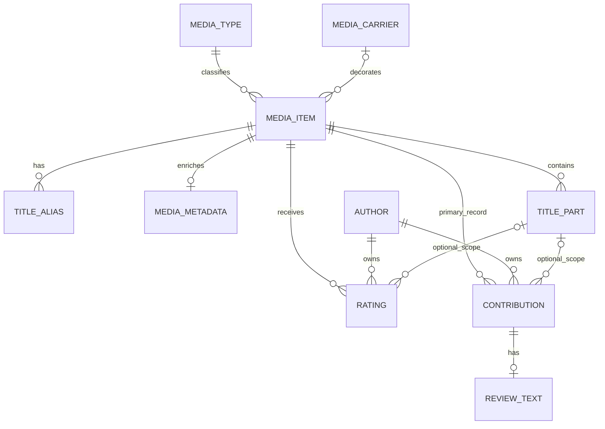
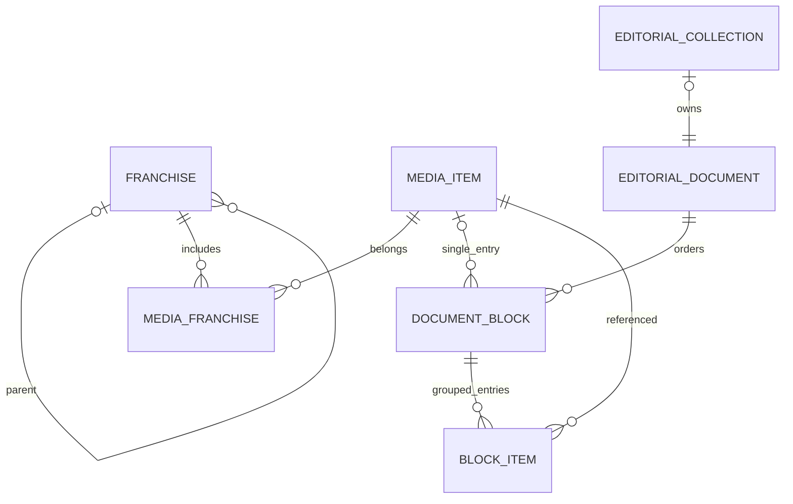
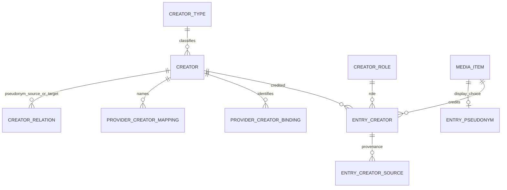

# Модель данных

Проверено по рабочему дереву 20 октября 2026 года. Это смысловая карта модели, а не перечень всех столбцов. Физические определения и ограничения находятся в [schema.ts](../../src/db/schema.ts); эксплуатационная схема разворачивается миграциями. [Общая карта](README.md), [провайдеры](PROVIDERS.md), [жизненные циклы](WORKFLOWS.md), [инварианты](INVARIANTS.md).

## Границы владения и источники истины

| Слой | Источник истины | Кто принимает решение |
| --- | --- | --- |
| Общий архив | `media_items`, серии и опубликованные связи | Администратор; автор до публикации своей заявки |
| Унифицированные справочники | Жанры, платформы, создатели, роли и сопоставления | Ручное решение администратора; ограниченные автоматические решения для отдельных провайдеров |
| Личная история | Оценки, статусы, опыт знакомства, авторские рецензии | Автор; администратор управляет публикацией рецензии |
| Внешний ответ | `provider_snapshots` | Провайдер; снимок сохраняет ответ, но не заменяет доменную модель |
| Рабочие метаданные | Нормализованные отношения и `media_item_metadata`; для ещё не переведённых путей — `facts` | Синхронизация с учётом сохранённых ручных решений |
| Производные данные | Агрегаты рейтингов, прогресс, доверие, ачивки | Пересчёт и обработчики событий, а не независимый пользовательский ввод |

Опубликованная запись — часть общего архива. `created_by_author_id` сохраняет атрибуцию вклада, а не персональное владение: авторские изменения ограничены черновиками и отклонёнными предложениями. Автор с профилем, разрешающим публикацию без проверки, может опубликовать запись непосредственно. Это отдельно от автоматической модерации. Основания: [продуктовые границы](../../PROJECT_CONTEXT.md), [операции с записями](../../src/db/queries/media-items.ts), [политика публикации](../../src/lib/authors/media-publication.ts).

## Запись, тип, носитель и часть

`media_items` — общая запись для всех типов медиа. Название, год, описание, обложка, статус публикации и технические отметки обработки живут на ней. Тип ссылается на редактируемый справочник `media_types`; `MediaType` в TypeScript является строкой, а не закрытым enum. Это позволяет управлять доступностью типов через данные, но специализированные сценарии всё равно явно проверяют коды `book`, `game`, `series` и другие. Добавление строки справочника само по себе не создаёт нового импортёра. [Типы и доступность](../../src/lib/media/types.ts), [схема](../../src/db/schema.ts).

Носитель `media_carriers` задаёт отдельную визуальную классификацию; связь `media_carrier_media_types` определяет совместимость носителей с типами. Альтернативные названия — отдельные `media_item_title_aliases`, используемые при поиске и проверке дублей, а не самостоятельные записи. [Дубли](../../src/lib/media/media-item-duplicates.ts), [операции с названиями](../../src/db/queries/media-items.ts).

`title_parts` — части одной записи: `season`, `issue`, `volume`, `part`. У части собственный ID, номер, порядок, описание, год, обложка и идентификатор источника. Это не дочерняя `media_items` и не серия. Оценка или рецензия могут относиться к записи целиком либо к части; составные FK не допускают привязки чужой части. Провайдерная синхронизация обновляет или добавляет части, сохраняет существующий ID, не удаляет исчезнувшие из ответа части и возвращает конфликты нумерации/источников. Сезон 0 считается спецвыпусками: новые импортируемые части такого вида отбрасываются, исторические оценки исключены из расчётов. [Синхронизация частей](../../src/db/queries/title-parts-sync.ts), [правила частей](../../src/lib/media/title-parts.ts), [расчёт оценок](../../src/db/queries/effective-ratings.ts).

## Серии и редакционные подборки — разные отношения

Серия реализована таблицей `franchises`: название, публикация, атрибуция и необязательный родитель. Это дерево с настраиваемой максимальной глубиной, а не универсальный граф связей произведений. Запись относится к нескольким сериям через `media_item_franchises`, причём публикация связи учитывается отдельно от публикации самой серии. В предложениях авторов отдельно моделируется запрос удаления уже существующей связи. [Серии и модерация связей](../../src/db/queries/franchises.ts).

При выборе нескольких узлов одной ветки сохраняются наиболее конкретные связи; принадлежность к предку вычисляется через потомков. Переподчинение серии удаляет избыточные прямые связи записей с предками. В публичных проверках учитываются опубликованная ветка и опубликованные связи. Это влияет на фильтры архива, страницы создателей и видимость жанров, заменяемых серией. [Выбор конкретных серий](../../src/db/queries/media-items.ts), [публичная принадлежность](../../src/db/queries/series-membership.ts).

Редакционная подборка `editorial_collections` владеет одним `editorial_documents`. Документ содержит упорядоченные блоки `media`, `heading`, `text`, `entry_group`; группа хранит упорядоченные ссылки на записи в `editorial_document_block_items`. Это составленная администратором публикация с текстом, а не классификация и не личная папка автора. Enum документа содержит `article`, но наличие значения в схеме не означает реализованную самостоятельную подсистему статей. [Блоки и их валидация](../../src/lib/editorial-documents/model.ts), [запись блоков](../../src/db/queries/editorial-documents.ts), [подборки](../../src/db/queries/editorial-collections.ts).

Редакционные ссылки имеют операционное значение: сохранять можно опубликованные записи, а использование записи в документе проверяется при изменении её публикации и удалении. Ссылками считаются и одиночный блок, и элемент группы; их нельзя учитывать только по `editorial_document_blocks.media_item_id`. [Общий учёт ссылок](../../src/db/queries/editorial-document-references.ts), [изменение публикации записи](../../src/db/queries/media-items.ts).

## Создатель, коллектив и псевдоним

`creators` — единый справочник персон, коллективов и организаций; тип определяется `creator_types`, работа в записи — `creator_roles`. `entry_creators` связывает запись, создателя и роль. Поэтому один создатель может выступать в нескольких ролях, а издатель или разработчик не требует отдельной основной сущности. `creator_series` — явная связь создателя с серией; она не подменяет авторство отдельных записей. [Схема](../../src/db/schema.ts), [запросы создателей](../../src/db/queries/creators.ts).

`creators.birth_date` и `death_date` — nullable календарные `DATE`, в приложении строки `YYYY-MM-DD` без часового пояса. FantLab заполняет только `NULL` у `person` без исходящей `pseudonym_of`, не переносит даты между связанными создателями и не заменяет заполненные значения. Редактор допускает ручное исправление/очищение; отдельного запрета автозаполнения пустой даты нет. При очистке последующая обработка может заполнить её снова. Неполные, невозможные и конфликтующие по порядку даты не применяются; биография и награды остаются только в полном снимке. [Маппер](../../src/lib/providers/creator-adapters.ts), [применение](../../src/db/queries/creator-provider-snapshots.ts).

Псевдоним — также `creator`, связанный направленным `pseudonym_of` с одной или несколькими персонами. Это позволяет показать коллективный псевдоним, сохранив настоящих авторов. На запись можно выбрать один отображаемый псевдоним через `entry_creator_pseudonyms`; выбор допускается, когда все связанные с ним авторы уже присутствуют в роли `writer`. Публичные запросы расширяют авторство на непосредственно связанных авторов в одном направлении. Это не рекурсивная система идентичностей, не произвольные алиасы и не модель членства организаций. [Выбор и раскрытие псевдонима](../../src/db/queries/creators.ts).

`provider_creator_bindings` связывает внешний ID с внутренним создателем; активная пара `(provider, external_creator_id)` уникальна. Для IGDB идентичность имеет вид `company:N`, для RAWG — `developer:N` или `publisher:N`, для FantLab/BGG — числовой ID. Пространства ID не взаимозаменяемы. `provider_creator_mappings` связывает нормализованное имя в контексте провайдера и типа медиа с создателем; это механизм для текстовых значений и вариантов имени, а не доказательство тождества произвольных персон. [Ограничения схемы](../../src/db/schema.ts), [обработка заявок](../../src/db/queries/creator-requests.ts).

`entry_creator_sources` хранит происхождение каждого принятого внешнего значения, его роль, binding и позицию. В отличие от простого флага «пришло от провайдера», оно позволяет сохранить несколько вариантов внешнего имени, сведённых к одной связи. Удаление одного источника не должно удалять ручную связь или связь с оставшимися источниками. Для игровых компаний дополнительно сохраняется рабочий roster внешних ссылок, профили и состояние бэкфилла; для книжных издателей рабочий состав восстанавливается из принятых sources и заявок, включая ещё не принятые/исключённые occurrences. [Удаление неподтверждённых связей](../../src/db/queries/creators.ts), [синхронизация](../../src/db/queries/creator-requests.ts), [книжные издатели](../../src/db/queries/book-publisher-roster.ts), [игровые компании](../../src/lib/creators/game-companies.ts).

## Жанры, платформы и заявки на унификацию

Внешнее слово не становится сразу внутренним справочником. `provider_*_mappings` переводят значения провайдера в внутренние `genres`/`platforms`; `provider_*_exclusions` сохраняют решение игнорировать значение. Неизвестные значения создают заявки, а таблицы occurrences связывают заявку со всеми затронутыми записями. Решение `create`, `map` или `exclude` сохраняется отдельно от состояния фонового применения `pending/applying/processed/failed`. Поэтому «администратор принял решение» и «все записи пересчитаны» — разные факты. [Жанровые заявки](../../src/db/queries/genre-requests.ts), [платформенные заявки](../../src/db/queries/platform-requests.ts), [заявки создателей](../../src/db/queries/creator-requests.ts).

Одно внешнее значение жанра или платформы может отображаться в несколько внутренних значений. У связи записи с жанром/платформой есть один текущий `provider` и независимый `is_manual`; при исчезновении внешнего значения ручная связь остаётся, а её провайдерное происхождение снимается. Это более простая модель происхождения, чем `entry_creator_sources`, и она не является полноценным многопровайдерным ledger. Платформенная унификация ограничена играми. [Жанры](../../src/db/queries/media-item-genres.ts), [платформы](../../src/db/queries/media-item-platforms.ts), [схема](../../src/db/schema.ts).

`genres.replacement_franchise_id` означает: если запись уже принадлежит соответствующей опубликованной ветке серии, не показывать повторяющийся жанр. Сам жанр и связь не удаляются. Если принадлежность ещё не принята, жанр остаётся видимым, а система может предложить недостающую связь с серией. [Видимость жанра](../../src/db/queries/media-item-genres.ts), [предложения серий](../../src/lib/media/genre-series-suggestions.ts).

У платформ отдельно моделируются внешние профили IGDB/RAWG, импортированные и ручные логотипы, режим `exact/combined` и версия ассета. Это зависимость управления изображениями от решений унификации, а не просто поле URL внутреннего справочника. [Профили и ограничения](../../src/db/schema.ts), [операции с логотипами](<../../src/app/admin/(protected)/platforms/logo-actions.ts>).

## Метаданные и снимки

Не смешивать три сущности:

1. `provider_snapshots` — сохранённый внешний ответ с идентичностью запроса, хешем и временем. `provider_snapshot_links` прикрепляет его к внутренней сущности с назначением `primary` или `dependency`. Сейчас серверный реестр знает `media-item` и `creator`; это полиморфная связь без FK на доменную цель. [Реестр сущностей](../../src/lib/providers/entities.ts), [операции со снимками](../../src/db/queries/provider-snapshots.ts).
2. `media_item_metadata` и рабочие отношения — подготовленные данные приложения. Для книжных провайдеров FantLab, Google Books и Open Library авторы и издатели читаются из `entry_creators`/`entry_creator_sources`, язык — из `facts.originalLanguage`; в хранимом JSON нормализованной книги остаётся только этот язык либо `{}`; совместимая форма `facts` вычисляется запросом, а сырой payload не нужен рендерингу. Остальные пути ещё используют сохранённый JSON `facts`. [Книжное чтение](../../src/db/queries/book-metadata.ts), [запись метаданных](../../src/db/queries/media-item-metadata.ts).
3. `media_item_provider_snapshots` — отдельная прежняя таблица снимка выбранных данных предложения автора. Она нужна проверке автомодерации и удаляется при ручном или автоматическом одобрении submitted-заявки; не каждый путь прямой публикации выполняет такую очистку. Это не общий raw-архив `provider_snapshots` и не взаимозаменяемая копия. [Политика автомодерации](../../src/lib/automoderation/media-policy.ts), [публикация](../../src/db/queries/media-items.ts).

Подробные границы перехода и повторной обработки описаны в [PROVIDERS.md](PROVIDERS.md). Редакционное/AI-описание `media_item_editorial_summaries` хранится отдельно, с `source_hash`, статусом и `locked`: это ещё одна проекция, а не внешняя истина. [Схема](../../src/db/schema.ts).

## Личная история, рецензии и доверие

Личная коллекция реализована состоянием автора относительно общего архива: `author_media_statuses`, `ratings`, `author_media_experiences`. В этой модели нет отдельной универсальной таблицы пользовательских папок, аналогичной редакционным подборкам. Дата знакомства хранится отдельно и имеет точность день/месяц/год. Статус wanted/skipped и оценка взаимоисключаются для пары автор/запись, включая оценки частей. [Схема](../../src/db/schema.ts), [состояния архива](../../src/lib/media/author-media-status.ts), [точность даты](../../src/lib/authors/media-experiences.ts).

Оценка хранится целым `10…100` с шагом 10, показывается как `1…10`. На запись или часть у автора одна явная оценка. Для общего рейтинга один автор даёт один эффективный голос: общая оценка, если она задана, иначе среднее оценок допустимых частей. Производная дробная оценка не записывается как новая явная оценка. `media_item_rating_stats` хранит агрегат количества голосов и суммы для каталога. [Эффективные оценки](../../src/db/queries/effective-ratings.ts), [агрегат](../../src/db/queries/media-item-rating-stats.ts).

`contributions` сейчас поддерживает только тип `review`; общий каркас не означает реализованные статьи или другие виды авторского контента. Текст живёт в `contribution_reviews`, публикация — в `contributions`, оценка — независимо в `ratings`. Поэтому изменение оценки отражается у рецензии без переписывания её текста. Рецензия имеет scope записи или части; уникальность распространяется на все статусы, а не только опубликованные тексты. Административное решение меняет статус/заметку, но не текст или оценку. Реакции относятся к тексту рецензии. [Типы вкладов](../../src/lib/contributions/model.ts), [операции с рецензиями](../../src/db/queries/contribution-reviews.ts).

Профиль доступа автора определяет права, лимиты и доступные типы медиа; XP/уровень и trust — отдельные проекции. `author_action_ledger` различает одноразовую награду за источник и исход модерации. Обработчик событий обновляет `author_progress`/`author_trust`; соответствующий настройкам кандидат может перейти из обычного профиля в доверенный. Учитываются уровень, очки доверия, доля успешных решений, длительность истории, блокировка и запрет автоповышения. Доверие не равно роли администратора и не заменяет серверную проверку прав. [Репутация](../../src/lib/reputation/service.ts), [настраиваемые правила](../../src/lib/reputation/model.ts), [профили](../../src/lib/authors/access-profiles.ts).

## Служебные отношения

Аккаунт и публичный автор разделены: `authors` хранит профиль и доступ, `author_accounts` и связанные identities/emails/sessions/challenges обслуживают вход. Администраторы хранятся отдельно. Дружба связывает авторов; викторины и участие, ачивки, уведомления и багрепорты ссылаются на существующее ядро, не владеют записями архива. [Схема](../../src/db/schema.ts), [общая карта подсистем](README.md).

Фоновые `jobs/job_runs`, события с transactional outbox, отметки потребления, email outbox и outbox транспорта уведомлений — разные виды состояния доставки. Они не заменяют доменные таблицы. Бизнес-изменение и запись соответствующего события фиксируются в одной транзакции; немедленная постановка dispatch происходит после commit, а восстановление опирается на сохранённый outbox. [Транзакционная граница](../../src/db/transaction.ts), [персистентность событий](../../src/lib/domain-events/persistence.ts), [жизненные циклы](WORKFLOWS.md).

### Метаданные фильмов TMDB

Полный ответ movie details с `credits` хранится в существующей `provider_snapshots` и связывается с записью через `provider_snapshot_links`. `media_item_metadata.facts` остаётся компактным рабочим JSON с прежними ключами длительности, жанров, стран, языка и производственных компаний. Существующие нормализованные отношения и проекция импорта для автомодерации не заменяются. `credits` не создаёт сущностей или отношений. Дополнительные legacy-поля сохраняются на переходном этапе; удаление допускается после проверки зависимостей и миграции. Подробности — [PROVIDERS](PROVIDERS.md#фильмы-tmdb-raw-и-компактные-характеристики).
