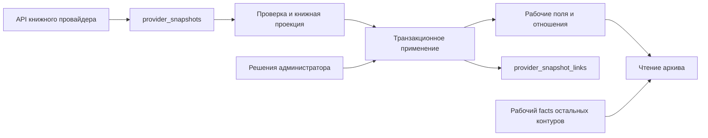

# Провайдеры и метаданные

Срез фактического кода: 20 октября 2026 года. Документ описывает реализованные пути, включая переходный книжный контур. Наличие миграций в репозитории не доказывает их применение или включение настроек в конкретной БД. Эксплуатационные команды и порядок книжного перехода находятся в [README проекта](../../README.md#исходные-снимки-книжных-провайдеров); жизненные циклы домена — в [WORKFLOWS](WORKFLOWS.md).

## Граница интеграции

Внешний источник предлагает сведения; опубликованная запись и редакционные решения принадлежат архиву. Общий интерфейс провайдера объединяет поиск записей, метаданные и обложки, но эти операции включаются и выполняются отдельно. Источник метаданных не обязан совпадать с источником выбранной обложки. Автоматическое обновление метаданных не заменяет обложку и основные редактируемые поля записи: общий job передаёт в сохранение `facts`, части и идентификатор источника, а не название или описание. Есть отдельные специализированные операции, например дополнение русских описаний аниме.

Источники: [типы контрактов](../../src/lib/covers/types.ts), [реестр](../../src/lib/covers/registry.ts), [обновление метаданных](../../src/lib/media/metadata-jobs.ts), [обложки](../../src/lib/covers/storage.ts).

| Медиа | Подключённые адаптеры |
|---|---|
| Фильмы, сериалы | TMDB |
| Аниме | Jikan, AniList, TMDB; Shikimori используется для дополнительного обогащения AniList |
| Книги | FantLab, Google Books, Open Library |
| Комиксы | Comic Vine |
| Игры | IGDB, RAWG |
| Roblox | Roblox |
| Настольные игры | BoardGameGeek |

Это перечень возможностей кода, а не перечень включённых интеграций конкретного окружения. Порядок, включение, `parallel`/`fallback`/`off` поиска записей и поиск обложек задаются административными настройками на пару «тип медиа + провайдер». Сначала выполняется параллельная группа; резервные источники вызываются последовательно, если первая группа ничего не нашла. Совпадения объединяются по `provider + externalId`, а не объявляются одной канонической записью разных провайдеров. Ключи API хранятся зашифрованными в БД; мастер-ключ шифрования остаётся конфигурацией развёртывания.

Источники: [подключения](../../src/lib/covers/providers.ts), [выбор источников](../../src/lib/covers/registry.ts), [настройки](../../src/db/queries/cover-settings.ts), [шифрование](../../src/lib/covers/credential-crypto.ts).

## Четыре разных слоя данных

| Слой | Смысл и владелец | Чего от него не следует ожидать |
|---|---|---|
| `provider_snapshots` | Полный ответ внешнего ресурса. Идентичность: провайдер, тип ресурса, внешний ID, метод API и хеш параметров запроса. Подключены книжный fetch-контур, фильмы TMDB и raw-профили Creator FantLab/TMDB/IGDB/RAWG. | Это последний ответ на такой запрос, а не неизменяемая история версий и не универсальное хранилище ответов всех адаптеров. |
| `provider_snapshot_links` | Принадлежность сохранённого ответа доменной сущности, с назначением `primary` или `dependency`. | Полиморфная ссылка не имеет FK на запись или создателя. |
| Рабочие поля и отношения | `media_items`, язык в `media_item_metadata.facts.originalLanguage`, связи жанров, платформ, создателей, их provenance и заявки. Содержат принятые решения архива. | Их нельзя заново строить с потерей ручного выбора при каждом сетевом ответе. |
| `media_item_metadata.facts` и `media_item_provider_snapshots` | Первый — рабочие ненормализованные характеристики: у книг поддерживаемых провайдеров только язык, у остальных типов — их действующий JSON. Второй — отдельная проекция выбранного импорта для проверки автомодерацией, одна на запись. | Проекция импорта не является полным raw-ответом; `facts` ещё нельзя удалить глобально. |

Схема: [schema.ts](../../src/db/schema.ts). Сохранение raw: [provider-snapshots.ts](../../src/db/queries/provider-snapshots.ts). Проекция импорта: [media-item-provider-snapshots.ts](../../src/db/queries/media-item-provider-snapshots.ts). Рабочие метаданные: [media-item-metadata.ts](../../src/db/queries/media-item-metadata.ts).



Raw не является зависимостью обычного отображения нормализованной книги. SQL-адаптер чтения строит совместимую форму `facts`: авторы/издатели берутся из рабочих связей, язык — из компактного сохранённого `facts.originalLanguage`. Существующее имя поля в DTO поэтому не означает чтение старого JSON. Источник: [book-metadata.ts](../../src/db/queries/book-metadata.ts).

Миграция `0132_book_language_facts` возвращает язык из отдельной колонки в JSON и удаляет `original_language`. Для уже нормализованных книг приоритет имеет непустое значение колонки (оно было видимым); при пустой колонке сохраняется язык из `facts`. Для остальных записей приоритет у существующего языка `facts`, а колонка служит только fallback. Ненормализованные книги и другие типы сохраняют остальные ключи. У нормализованных книг проверяются неизвестные характеристики, затем остаётся только язык; авторы, издатели, provenance и решения не меняются. Перенос и DROP выполняются одной транзакцией с блокировкой metadata до проверки; миграция не запускает сеть или повторный импорт. Новый индекс для языка не нужен: поиска/сортировки по нему нет.

Проверка переноса языка: `book-language-facts-migration.test.ts` проверяет приоритеты, rollback, сохранность других типов и DROP; с `PROVIDER_SNAPSHOT_PERF_TEST=1` — реальную запись только в изолированную схему из 300 000 строк (100 000 нормализованных книг). UPDATE изменил только нужные 100 000 строк, 5,50 с; план читает metadata двумя ограниченными проходами и media_items одним, без коррелированных циклов по всему набору, с hash join и временными блоками (~46 МиБ при тестовом work_mem). Это однократная миграция с эксклюзивной блокировкой metadata, поэтому для большой БД нужен соответствующий интервал обслуживания. Чтение совместимой формы проверено на 100 000 книг/300 000 sources: точечные запросы используют PK/provenance-индексы, около 0,20 мс для нормализованных записей, без raw. Замена столбца на JSON-ключ не меняет join/filter/order выражения; новый индекс не требуется. Полная пропускная способность приложения этими измерениями не проверяется.

## Фильмы TMDB: raw и компактные характеристики

Только пара `tmdb + film` использует снимок `tmdb / movie / ID / movie.details / {language:"ru-RU",append_to_response:"credits"}`. Полный JSON movie details сохраняется без отбора полей, включая неизвестные поля и `credits.cast/crew`. Это последний ответ, а не история версий. Поиск и обложки, сериалы и аниме не переводятся на этот контур.

Чистый [маппер фильма](../../src/lib/providers/tmdb-film-adapter.ts) строит собственную проекцию: `runtimeMinutes`, `productionCountries`, `originalLanguage`. Ни `credits`, ни другие неизвестные raw-поля не копируются в `facts`. Из участников обрабатываются `production_companies` и режиссёры `credits.crew[job=Director]` по контурам ниже; актёры и остальные профессии не импортируются. Существующая синхронизация жанров и её решения модерации продолжают работать. Внешние жанры проецируются из raw только на время сопоставления; в `facts` не сохраняются. Повторное применение решений и повторное открытие жанров читают связанный primary-снимок текущего источника. Внутренние жанры хранятся только в `media_item_genres`, без дублирования ID в JSONB. Миграция `0134` проверяет наличие корректного снимка перед очисткой `facts.genres` и `facts.genreReferences`; сеть не используется, остальные характеристики и ручные связи не меняются. Код и миграция выкладываются вместе с обновлением workers: старые workers нужно остановить до очистки, иначе они могут вернуть устаревшие поля. Публичные потребители читают прежний контракт `facts`, без обращения к raw. Название, оригинальное название, год и описание формы по-прежнему берутся из выбранного результата поиска: сервис фильма не возвращает `fields`, в том числе при `enrichTitleFields`. Фоновые операции их не изменяют.

[Сервис](../../src/lib/providers/tmdb-film-service.ts) резервирует квоту на фактический HTTP-запрос, использует существующие credentials, timeout, ограничение размера JSON и инфраструктуру снимков. Ответ другого ID или неполный ответ (включая отсутствие запрошенного `credits`) не заменяет usable raw. При применении проверяются дескриптор, `id + payloadHash`, тип записи и ожидаемый источник; `facts`, snapshot links и checkpoint записываются атомарно под блокировкой записи и guard задания. Клиентский JSON не заменяет серверную проекцию. Пустые значения опускаются по прежнему контракту registry; выбор только источника без импортированных метаданных по-прежнему можно сохранить без успешного запроса деталей. Отдельная проекция импорта `media_item_provider_snapshots` для автомодерации сохраняет свою функцию.

Общий `provider.snapshots` принимает `provider:"tmdb"` для фильмов; отсутствие provider сохраняет прежнюю книжную семантику. `refresh` получает raw и привязывает его без изменения рабочих данных; `process` строит проекцию только из сохранённого raw, без сети и credentials; `refresh-process` совмещает этапы; `verify` сравнивает существующие характеристики с проекцией, записывая расхождения в результат задания. Повторы используют raw, полученный после создания запуска. Партии используют существующие фиксированную верхнюю границу, keyset, checkpoint и ограниченные ошибки. Изменение source или snapshot hash не позволяет применить устаревший результат.

На переходном этапе дополнительные legacy-поля сохраняются при применении к прежнему TMDB-источнику; нужные ненормализованные характеристики (в том числе уже имеющиеся студии/прокатчики) остаются в `facts`. После проверки фактических данных, всех потребителей и успешной миграции неиспользуемые поля можно удалить отдельным целевым изменением. Автоматическое удаление неизвестных ключей не выполняется: универсальное отображение характеристик умеет показывать и неизвестные ключи. Raw при очистке рабочего JSON не сокращается.

Проверенные потребители: отображение характеристик и карточек, длительность в сводках записей и групп, вход редакционных описаний, экспорт, синхронизация и заявки жанров, подписанные metadata-кандидаты и формы, проекция автомодерации. Сохраняются ключи и типы; существующие ручные создатели не пересинхронизируются из TMDB.

Выборка партии использует существующий `(source_provider, media_item_id)` и PK записи; диапазон ID ограничен на обеих сторонах join, нет `OFFSET`, отдельного `COUNT` или размножения по связям. Проверка фактического `.toSQL()` воспроизводится тестом `provider-tmdb-film-query-plan.test.ts` с `PROVIDER_SNAPSHOT_PERF_TEST=1` и `DATABASE_URL` изолированной БД. На PostgreSQL 17 с 300 000 записей (10% фильмов и 10% сериалов с тем же провайдером), после `ANALYZE`, партия из 26 строк читает 260 строк каждого PK-диапазона, 0,144 мс/13 buffers. Прежняя форма join с диапазоном только на metadata читала префикс 150 260 записей, 22,848 мс/1232 buffers. Для редкого источника (1 совпадение) — составной индекс, 0,027 мс/8 buffers; отсутствующего — 0,020 мс/5 buffers. Перед повторным замером изменённого распределения выполняется `VACUUM ANALYZE`, чтобы не измерять созданные тестом мёртвые записи. Новые точечные запросы подготовки, сравнения и проверки типа используют PK/существующую уникальность дескриптора. Замеры синтетические, без HTTP и fan-out рабочих отношений; они не измеряют пропускную способность всей job. Новые индексы не требуются.

### Публичное чтение компаний фильмов

После регистрации полного состава `productionCompanies` больше не хранится в `facts`. Совместимый read DTO для сводок, редакционных описаний и экспорта восстанавливает список имён из `entry_creators` и сохранённых `creator_request_media_items`; raw JSON не читается. Подтверждённая компания получает ссылку только при наличии рабочего участия Creator; до применения решения остаётся подпись заявки. Исключения и вручную переоткрытые заявки учитываются при чтении. Ручное участие сохраняет видимость независимо от исключения автоматического источника. Пока legacy-ключ существует, отображение использует его; пустой перенесённый состав не возвращает старые значения. Это форма чтения, её нельзя сохранять обратно как импортированные характеристики. [SQL-проекция](../../src/db/queries/tmdb-company-display.ts), [совместимый DTO](../../src/db/queries/book-metadata.ts).

Для всех Creator действует одна страница `/archive?creator=<slug>`. Вкладки формируются по опубликованным связанным записям и доступным пользователю типам, независимо от поиска, роли и остальных фильтров; предпочтение отключить тип в обычном архиве не является запретом доступа. Прямое открытие выбирает «Все», ссылка компании из фильма задаёт `type=film`. Переключение сохраняет контекст и сбрасывает страницу; «Все» удаляет `type`, недоступное значение нормализуется URL-переходом. Принадлежность использует общую семантику `creatorCondition`, включая непосредственные псевдонимы. [Запрос](../../src/db/queries/creators.ts), [страница](../../src/app/archive/page.tsx).


### Компании фильмов TMDB

`production_companies` читаются из primary movie snapshot текущего источника записи. `tmdb / company:<ID>` — общая внешняя идентичность организации, независимо от будущего типа медиа; участие фильма имеет роль `production_company`. Неполный/некорректный список — ошибка, `[]` — полный пустой состав. Имена не заменяют ID; повтор ID с противоречивыми данными отклоняется.

Синхронизация под блокировкой записи регистрирует заявки и основания участия; в той же транзакции удаляет только хранимый `facts.productionCompanies`. Ожидание модерации не препятствует очистке. Рабочие связи возникают из подтверждённых bindings, сохраняются ручные признаки и сторонние sources. Автоапрув выполняется отдельной `media.tmdb-company-approve` через обычное `resolveCreatorRequest` → `media.creator-request-apply`: подтверждённый ID, затем сохранённое ручное name-only сопоставление, затем единственный точный нормализованный кандидат без конфликтующего ID; организация создаётся только при отсутствии кандидатов. Сохранённое сопоставление к другому типу Creator требует ручной проверки. Исключения (в том числе прежние name-only), ручное переоткрытие, неоднозначные кандидаты и разные варианты имени требуют ручного решения; похожие названия не объединяются. Применение решения перечитывает текущий связанный snapshot без сети.

Имя, `logo_path` и snapshot provenance кешируются в существующем `game_company_profiles` с provider=tmdb. Более старый снимок не переписывает новый профиль. Заполнение и явное обновление изображений Creator выполняет общий image-координатор через универсальные raw-профили, image relay, contain для логотипа и avatar storage. Отдельная массовая задача `media.tmdb-company-logos` снята с эксплуатации. Ошибка изображения не отменяет модерацию или участие.

Обычное применение метаданных ставит jobs апрува и логотипов. `provider.snapshots` в режиме обработки без сети не ставит загрузку логотипов. Ручная `media.tmdb-companies-backfill` также работает без сети, поддерживает `dryRun`, `mediaItemId`, `batchSize` (1–100, по умолчанию 25), ограниченный диапазон ID, durable checkpoint и отложенное продолжение; не меняет остальные facts. Апрув проходит тем же стандартным флоу. Для недостающих изображений запускается отдельная ручная `media.tmdb-company-logos` с `{}` или `externalIds`. Ошибки бэкфилла сохраняют ID в отчёте; после исправления причин запись повторяется адресно либо новым проходом.

Миграция `0135` расширяет CHECK существующих таблиц, добавляет справочные коды и два expression-индекса точного нормализованного имени Creator, не очищает данные массово. Перед переносом обновить код и все workers: старый worker способен вернуть legacy поле. Порядок rollout: остановить старые workers → применить миграции → запустить обновлённые приложение/workers → dryRun → перенос → отдельная загрузка логотипов. Приложение не требует новых environment variables или company API.

Проверка SQL компаний (21 октября 2026): изолированный PostgreSQL 17, 100 тыс. записей, 1 млн участий, около 10 тыс. организаций, по 100 тыс. профилей/привязок, актуальный `ANALYZE`. На фактических запросах `EXPLAIN (ANALYZE, BUFFERS)` показал: вкладки популярного Creator — около 117 мс/2464 buffers; count для популярного/редкого/отсутствующего Creator — 114/0,42/0,05 мс; первая страница — 94/0,17/0,04 мс. Выборка логотипов по keyset — 0,07 мс/9 buffers, кандидаты аватара — 0,10 мс/47 buffers, точная идентичность — 0,02 мс/4 buffers. Публичная проекция компаний одной записи — 0,15 мс/41 buffers, без запросов к raw. Отдельное сравнение на 10 тыс. организаций подтвердило совпадение expression-индексов с реальным SQL: поиск точного name/originalName сменил Seq Scan (15,57 мс/65 buffers) на BitmapOr двух индексов (0,04 мс/6 buffers). Для 29 форм доменных INSERT/UPDATE/DELETE проверен `EXPLAIN` без исполнения мутаций. Воспроизводимые сценарии: [runtime/perf](../../tests/tmdb-company-runtime.test.ts), [индексы и варианты имени](../../tests/tmdb-company-query-plan.test.ts).

Ограничения измерения: у Creator, связанного со всеми 100 тыс. записей, count/вкладки закономерно читают весь связанный состав; существующий `creatorCondition` строит большой набор принадлежности и для первой страницы. Проверка вариантов имени одного ID на 100 тыс. наблюдений остаётся линейной по составу: новый DISTINCT возвращает максимум две строки вместо прежних 100 тыс., но нормализация в PostgreSQL заняла 129 мс против 12 мс простого чтения имён (редкое/отсутствующее наблюдение — 0,03/0,01 мс). Это фоновая проверка идентичности, а не путь публичной страницы. Keyset ограничивает размер партии и результат, но не обещает постоянную стоимость фильтра/агрегации. Измерения синтетические, не включают сетевую загрузку и S3, холодный кеш и производственную конкурентность; сопутствующий рефакторинг общих архивных запросов не выполнялся.

## Книги: получение и применение разделены

### Авторы FantLab

Авторы используют тот же `provider_snapshots`/`provider_snapshot_links` и тип job `provider.snapshots`: `entityType: "creator"`, `provider: "fantlab"`, необязательный `creatorIds`. Payload без `entityType` сохраняет книжную семантику. Дескриптор автора — `fantlab / author / externalId / autor.get / {biography:1,awards:1}`; полный ответ `GET /autor/{id}?biography=1&awards=1` сохраняется в JSONB, включая неизвестные поля. На авторах №1, №2 и №3 проверено: даты — `birthday`/`deathday`, биография — строка, награды — объект; без параметров оба раздела отсутствуют. Тестовые fixtures сохраняют полные проверенные ответы.

FantLab может вернуть HTTP 404 с полным JSON существующего автора и `is_opened=0`: это подтверждено на Кене Кизи, ID 10433, и сохранено отдельной fixture. Только snapshot-вызов по уже подтверждённой привязке допускает такой 404 после ограниченного чтения тела и проверки `autor_id`/`id`, `type=autor`, имени, допустимого `is_opened` и полноты запрошенных разделов. HTML, ошибка, чужой ID и неполный JSON не принимаются. Признак `is_opened=0` сохраняется в raw и диагностике; он не разрешает сменить внешнюю идентичность. Обычная проверка новых привязок и поиск по имени остаются строгими. Вариант имени в `provider_creator_mappings` и привязка ID в `provider_creator_bindings` — разные свидетельства одного Creator, а не две внутренние персоны; их нельзя автоматически сливать/удалять из-за одинаковой подписи в админке.

`refresh` получает и привязывает снимок, не меняя даты; `process` работает только с сохранённым ответом без сети; `refresh-process` совмещает этапы. Книжный `verify` для Creator запрещён. Выбирается только единственная активная подтверждённая привязка; отсутствие/неоднозначность требует ручного решения, поиск по имени не выполняется. Подтверждение заявки FantLab транзакционно создаёт отдельную job обогащения; сетевой сбой не откатывает уже созданного автора.

Маппер заполняет только пустые полные даты жизни персоны без исходящей связи псевдонима; имена, привязки, аватары и отношения не меняются. Перед применением под блокировкой Creator проверяются источник и `id + payloadHash`; даты, links, диагностика и checkpoint сохраняются атомарно с начальной/финальной проверкой lease. Используется общий Redis-слот FantLab с паузой минимум секунду, ограниченный транспорт, `Retry-After` и повторы средствами jobs. Возобновление использует снимок, полученный после создания job, если он уже сохранён.

Ручной бэкфилл доступен в общей админке снимков, отдельные операции — в карточке Creator. Партии имеют фиксированную верхнюю границу, keyset-курсор, ограниченные ошибки/диагностику и штатное отложенное продолжение. Массовая выборка читает уникальные Creator ID из активных привязок FantLab через частичный индекс `(provider, creator_id) WHERE active`, без `COUNT`, `OFFSET` и размножения строк при нескольких привязках. Явный набор ID выбирается по PK Creator. Даты не индексируются.

Для `refresh` и `refresh-process` доступен общий фильтр `onlyMissingSnapshots`; для Creator он выбирает только Creator с активной привязкой, у которых отсутствует снимок точного дескриптора `fantlab / author / externalId / autor.get / {biography:1,awards:1}`. Проверка использует `NOT EXISTS` по существующему уникальному индексу снимков и не зависит от дат, биографии или других рабочих полей Creator, наличия snapshot links и давности ответа. Ответ другого метода, ресурса или с иными параметрами не считается подходящим снимком. Сохранённый полный raw пропускается даже до применения к Creator; для повторного извлечения полей из него используется `process` без сети. Фильтр несовместим с `process` и не меняет старые payload без этого признака.

Перед сетевой работой фильтрованный запуск сохраняет `checkpoint.retryId`: после сбоя между сохранением raw и применением текущий Creator остаётся в выборке до завершения попытки. Возобновление использует уже сохранённый снимок без повторного получения, а успешный commit атомарно очищает marker вместе с продвижением курсора. Новый запуск без такого marker пропускает сохранённый raw. Если поля Creator остались пустыми из-за отсутствия сведений у провайдера, этот режим не заставляет повторно загружать профиль.

Фильтр проверен через SQL/`EXPLAIN (ANALYZE, BUFFERS)` на 100 000 синтетических Creator, 300 000 привязок (две FantLab и одна другого провайдера на Creator), до 200 000 снимков. Без фильтра партия использует индекс активных привязок; при частых пропусках — индексный anti-join (около 0,5 мс для партии 26). При десяти оставшихся или полностью заполненном диапазоне план делает до 200 000 точечных проверок уникального индекса снимков: около 1,0–1,1 с локально. Возобновление с marker использует однопроходный hash-план, около 0,21 с. Повторных полных сканирований в коррелированных циклах нет, но поиск редких пропусков растёт с числом привязок; эти измерения не являются SLA продакшена. Новые индексы не потребовались. Сценарии и масштаб воспроизводятся в `tests/creator-provider-snapshots-runtime.test.ts`.

Проверка SQL на изолированной БД: 200 000 Creator, 840 000 привязок (по четыре других источника на Creator и по две FantLab у 10%), 10 000 связей псевдонимов, актуальная статистика `ANALYZE`. До/после индекса проверены обычная партия, редкий и отсутствующий результат: `Index Scan → Index Only Scan`, без общей сортировки; партия 26 Creator читает не более 52 строк FantLab. В измерении обычной партии время составило 0,197 → 0,080 мс, редкой 0,018 → 0,041 мс, отсутствующей 0,029 → 0,023 мс — эти локальные времена не являются SLA. Явные ID и состояние Creator используют PK; `pseudonym_of` — индекс первичного ключа связей; проверка привязки ограничена индексом Creator и локальной сортировкой его строк. Изменение даты проверено через `EXPLAIN` без исполнения. Обработка каждого Creator требует собственных проверок/транзакции; пакетная выборка не делает отдельных запросов на строки списка. Сеть и производственная нагрузка этими SQL-измерениями не моделируются.

Источники: [адаптер](../../src/lib/providers/creator-adapters.ts), [получение](../../src/lib/providers/creator-service.ts), [применение и выборка](../../src/db/queries/creator-provider-snapshots.ts), [общая job](../../src/lib/providers/snapshot-job.ts).

### Книжный контур

Для FantLab сохраняется ответ произведения `search-ids`, для Google Books — `volumes.get`, для Open Library — `works.get` и отдельные `authors.get`. Дескрипторы и внешние ID проверяются сервером; произвольный метод или URL из запроса не выполняется. Проверяется соответствие ресурса запрошенному ID и полнота состава авторов. Open Library требует все зависимые ответы; неполный комплект нельзя применить. Перенаправление объединённого произведения Open Library требует выбора нового источника в редакторе, а не скрытого переназначения локальной записи.

Ответ ограничен 2 МиБ. Валидный raw может сохраниться до получения всех зависимостей: это позволяет продолжить прерванный fetch, но наличие основного ответа ещё не означает готовность книги к обработке. Клиент получает ссылки `id + payloadHash`, а не raw JSON. Старый подписанный выбор без ссылок на снимки принимается только после серверного получения полного комплекта. При применении повторно проверяются хеши под блокировкой; ответ, изменившийся после открытия формы, не применяется молча.

Источники: [адаптеры](../../src/lib/providers/book-adapters.ts), [ограниченный fetch](../../src/lib/providers/book-fetch.ts), [комплекты и ссылки](../../src/lib/providers/book-service.ts), [совместимость старых форм](../../src/lib/providers/book-form-mutation.ts).

Сетевой запрос и транзакция применения разделены, чтобы не держать блокировку записи во время внешнего API. При применении `upsertMediaItemMetadata` проверяет действующую lease фоновой задачи, блокирует запись, проверяет ожидаемый источник и снимки. Рабочие изменения, provenance-ссылки и checkpoint книжной задачи фиксируются атомарно. Это защищает от запоздавшего worker и от результата HTTP для уже сменившегося источника. При сохранении raw выигрывает запрос с более поздним временем **начала** по часам БД; медленно завершившийся старый запрос не должен затереть новый.

Источники: [транзакция применения](../../src/db/queries/media-item-metadata.ts), [lease, порядок сохранения и ссылки](../../src/db/queries/provider-snapshots.ts).

Книжная нормализация сейчас отвечает прежде всего за авторов. Адаптеры возвращают `writer` и возможные поля для формы; издатели переносятся из существующего рабочего provenance, а до переключения — также из исторического JSON при том же провайдере. Это не универсальная нормализация всех библиографических полей. Подготовленная книжная проекция не очищает жанры и платформы: их состав она не предоставляет и не владеет им.

Источники: [BookProjection](../../src/lib/providers/types.ts), [издатели](../../src/db/queries/book-publisher-roster.ts), [сохранение](../../src/db/queries/media-item-metadata.ts).

### Контракт полей формы при переходе на снимки

Сохранение полного raw не доказывает сохранность данных в форме. Для выбора новой записи проверяется вся цепочка: raw → проекция → `MediaTitleMetadata.fields` при `enrichTitleFields` → форма. Поля формы — `title`, `originalTitle`, `releaseYear`, `description`; отсутствие, `null` и пустые значения в подробном ответе не очищают данные выбранного поискового результата. Выбор другого результата сначала сбрасывает поля по новому кандидату, поэтому значения прежней записи не переносятся. Фоновые jobs без `enrichTitleFields` по-прежнему не получают команду менять редакционные поля записи.

| Провайдер | Название | Оригинальное название в текущей форме | Год | Описание |
|---|---|---|---|---|
| FantLab | `name` / `work_name` / `title` | `name_orig` / `work_name_orig` | `year` / `work_year` | `description` |
| Google Books | `volumeInfo.title` | `volumeInfo.subtitle` — прежнее правило формы сохранено | год из `volumeInfo.publishedDate` | `volumeInfo.description` |
| Open Library | `title` | отдельного поля нет; сохраняется поисковое значение | год из `first_publish_date` | строка `description` или `description.value` |

При следующем подключении/переходе провайдера обязательны: fixture полного ответа с независимо заданными ожидаемыми полями, проверка обоих вариантов `enrichTitleFields`, offline replay, неполного ответа и смены кандидата; отдельно сохраняются существующие гарантии состава авторов/идентичности и ручных данных. Не выводить покрытие из наличия JSONB или только проверки `facts.authors`. [Контрактные тесты](../../tests/provider-title-fields-contract.test.ts) имеют исчерпывающие fixtures для `BookProviderCode`, а общие сценарии формы — для `MediaProviderCode`: новый код провайдера требует расширить проверку при typecheck. [Адаптеры](../../tests/provider-book-adapters.test.ts) проверяют также транспорт и библиографические связи.

Форматы внешних полей: [Google Books Volume](https://developers.google.com/books/docs/v1/reference/volumes), [Open Library JSON API](https://openlibrary.org/dev/docs/api/books).

## Постоянный контракт книжных данных

FantLab, Google Books и Open Library постоянно используют рабочие связи авторов и издателей,
а язык хранится в `facts.originalLanguage`. При отсутствии языка persisted `facts` равен `{}`.
Обычное чтение не использует raw; импорт и повторное применение требуют проверенных snapshot
references. Ручные участники и псевдонимы сохраняются. Провайдеры других типов не меняются.

Миграция `0133_book_snapshot_contract` удаляет временный `provider_settings.normalized_book_metadata`.
Перед DROP она блокирует связанные таблицы и отвергает БД, где есть книги поддерживаемого
провайдера с false/отсутствующей прежней настройкой. Пустые провайдеры не блокируют новую БД.
Незавершённый переход необходимо закончить на предыдущей версии; автоматического импорта или
изменения решений миграция не выполняет. Смена режима, старая ветка чтения и инструмент
cutover удалены. SQL-проверка провайдера теперь использует фиксированный серверный список,
без чтения настроек. [Совместимое чтение](../../src/db/queries/book-metadata.ts).

Для книг и фильмов `onlyMissingSnapshots` использует `NOT EXISTS` основного raw точного
дескриптора текущего источника. Проверяются provider/resource/external ID/API method/params;
запрос не читает payload, links или рабочие характеристики. У Open Library проверяется основной
work, не полный комплект зависимостей. Существующий уникальный индекс raw используется по
первым четырём ключам, JSONB params проверяются дополнительным фильтром. На ID-диапазон обеих
сторон join накладывается keyset-граница; N+1 сетевых/SQL-вызовов для отбора нет. Перед fetch
записывается `retryId`: OR по этому ID сохраняет начатую запись в выборке, даже если raw уже
сохранён. После успешного применения/привязки checkpoint очищает retryId атомарно с результатом.
Для `process` и `verify` фильтр запрещён: им нужен сохранённый комплект. Это не ledger применения.

Планы общего фильтра проверены фактическим `.toSQL()` в `provider-tmdb-film-query-plan.test.ts`:
300 000 записей, включая фильмы и сериалы одного провайдера, и более 100 000 raw. Партия из
26 отсутствующих снимков — 1,216 мс/195 buffers для TMDB и 0,909 мс/226 buffers для FantLab.
Редкое/отсутствующее совпадение в диапазоне 150 000 ID требует пройти кандидатов и выполнить
индексные проверки raw: 113,075/96,542 мс, около 62 260 buffers. Стоимость растёт с числом
проверяемых источников, а не размером payload; новые индексы и чтение raw JSON не нужны.
Это синтетический замер отбора, не пропускной способности HTTP/jobs.

## Обновление, обработка и бэкфиллы

Разовая задача `provider.snapshots` работает по известным источникам книг; она не ищет соответствия по названию.

| Операция | Сеть | Изменение рабочих данных |
|---|---|---|
| `refresh` | Получить комплект raw | Нет; привязать доказательства к записи |
| `process` | Нет | Применить сохранённый комплект |
| `refresh-process` | Получить комплект | Применить комплект |
| `verify` | Нет | Нет; сравнить старых авторов с проекцией источника |

`verify` — сравнение текущих данных с проекцией источника, которое может показать несовпадение имён даже при осознанном ручном решении. Массовая задача фиксирует верхнюю границу ID, курсор и счётчики, повторяет временную ошибку отдельной записи до трёх раз, затем сохраняет её ошибку и продолжает обход. Лимиты откладывают выполнение через штатный defer; при обычном возобновлении используются ответы, полученные не раньше создания этого запуска; для missing-only допустим уже сохранённый основной ответ любого возраста. Хранятся последние 100 ошибок, а общий счётчик ошибок не ограничен этим числом. Для повторной обработки ошибок нужен новый запуск с нужными ID или диапазоном.

Источники: [handler](../../src/lib/providers/snapshot-job.ts), [payload/checkpoint](../../src/lib/providers/snapshot-job-payload.ts), [узкое сравнение](../../src/lib/providers/snapshot-report.ts), [диагностика](../../src/lib/providers/snapshot-item-errors.ts).

Другие контуры сохраняются отдельно:

- Общий `media.metadata-backfill` берёт записи с отсутствующими метаданными; при известном источнике обращается по ID, иначе ищет и ранжирует кандидатов. По умолчанию обрабатываются опубликованные записи, размер выборки ограничен. `force`, фильтр типа и режим только частей задают отдельный охват. `media.metadata-refresh` автоматически выбирает устаревшие метаданные только сериалов и аниме, а не всех типов. [Выборка](../../src/db/queries/media-item-metadata.ts), [backfill](../../src/lib/media/metadata-backfill.ts), [общая логика](../../src/lib/media/metadata-jobs.ts).
- Части сериалов TMDB синхронизируются вместе с метаданными; клиентский кандидат не считается доверенным списком частей. При выборе источника создаётся дополнительный fetch частей; загрузка постеров вынесена в отдельные jobs. [Точка координации](../../src/db/queries/media-item-metadata.ts), [синхронизация частей](../../src/db/queries/title-parts-sync.ts).
- Shikimori через AniList дополняет русские aliases и подходящее для обновления описание. Решение заново вычисляется по текущим данным под блокировкой; при достижении лимита aliases ради русского варианта может заменяться последний alias. Это специализированный путь редактирования основных полей, не обычный metadata refresh. [Политика](../../src/lib/media/anime-shikimori-backfill-core.ts), [применение](../../src/db/queries/anime-shikimori-backfill.ts).
- Игровой бэкфилл имеет собственную операцию, checkpoint каждой записи, сохранённый полный roster компаний и кеш профилей. IGDB запрашивается пакетами, RAWG — по записи. Источник повторно проверяется после сети и под блокировкой; затем roster синхронизируется и безопасные заявки могут автоодобряться. [Handler](../../src/lib/creators/game-company-backfill.ts), [постоянный прогресс](../../src/db/queries/game-company-backfill.ts).
- BGG-бэкфилл добавляет технические `bggCreators`, сохраняет редактируемые поля и выполняет отдельный автоапрув. `dryRun` не меняет доменные данные, но обращается к API и пишет отчёт. Продолжение создаётся новой задачей с курсором; ошибки отдельных записей остаются в журнале. [Handler](../../src/lib/creators/bgg-backfill.ts). Ограничения интеграции, кеш и права использования — в [BGG](../integrations/bgg.md).

## Создатели: идентичность, состав и изображения

Имя внешнего участника, подтверждённая идентичность и участие в записи — разные вещи. `provider_creator_mappings` сопоставляет нормализованное имя; `provider_creator_bindings` закрепляет внешний ID за каноническим создателем. `entry_creator_sources` хранит основания участия с ролью и позицией; `entry_creators.is_manual` защищает ручное участие при очистке импортированного состава. Заявки и исключения — самостоятельные долговременные решения: повторный импорт не должен заново автоматически одобрять вручную переоткрытое или исключённое соответствие.

FantLab с ID разрешается по binding; совпадение имени не выбирает и не заменяет создателя. Состав с неполностью разрешённой идентичностью не должен стирать прежний provenance целиком. BGG и игровые компании также имеют специализированные ID-пути. Для RAWG `developer:<id>` и `publisher:<id>` различны; у IGDB идентификатор компании `company:<id>` может участвовать в разных ролях. У книжных провайдеров без закреплённой идентичности действует путь именных соответствий, с заявками на неизвестные значения.

Источники: [координатор](../../src/db/queries/creator-requests.ts), [FantLab и издатели](../../src/db/queries/book-contributors.ts), [BGG](../../src/db/queries/bgg-creators.ts), [компании игр](../../src/db/queries/game-companies.ts), [prune](../../src/db/queries/creators.ts).

Миграция старых FantLab-вариантов имени в binding и синхронизация аватарки — отдельные разовые задачи. Первая требует единственного точного совпадения всех вариантов с одним ID, проверки карточки и отсутствия другого владельца ID. Вторая не заменяет ручной аватар, требует подтверждённой привязки, проверяет версию при commit и удаляет неиспользованный загруженный объект при конфликте. Профили и изображения игровых компаний имеют свой кеш и процедуру обогащения; это не общий книжный raw-контур.

Источники: [FantLab-sync](../../src/lib/creators/fantlab-sync.ts), [jobs](../../src/lib/creators/fantlab-jobs.ts), [версионирование аватаров](../../src/db/queries/creator-avatars.ts), [игровые профили](../../src/lib/creators/game-company-images.ts).

## Жанры, платформы и лимиты — общие зависимости

Метаданные не создают канонические жанры и платформы напрямую. Внешние значения разрешаются через соответствия, а неизвестные значения попадают в заявки с occurrences записей. Рабочие provider-связи и ручные решения хранятся отдельно. Поэтому обновление одного источника может породить модерацию в нескольких подсистемах. Общий порядок блокировок в metadata upsert: запись → ключи заявок жанров → ключи заявок платформ; произвольно менять его опасно.

Источники: [metadata upsert](../../src/db/queries/media-item-metadata.ts), [жанры](../../src/db/queries/media-item-genres.ts), [платформы](../../src/db/queries/media-item-platforms.ts). Отдельный rollout платформ описан в [существующем документе](../data/platform-rollout.md).

Счётчики лимитов распределены через Redis, но единица учёта неодинакова:

- Общий лимитер считает допуск операции адаптера; авторские ограничения проверяются отдельно. При недоступности Redis запросы с такими ограничениями возвращают ошибку проверки, а фоновые процессы откладываются.
- Книжный raw-fetch резервирует квоту на каждый HTTP, включая зависимых авторов Open Library; фоновый fetch сохраняет резерв 100 запросов.
- IGDB/RAWG считают HTTP на транспортной границе, с общими суточными, секундными, конкурентными ограничениями и cooldown по `Retry-After`. При недоступном Redis транспорт закрыт. Игровой бэкфилл также оставляет резерв 100 запросов.
- FantLab дополнительно имеет распределённый слот запроса; BGG — собственные кеш, leases и минимальный интервал, описанные в его интеграционном документе.
- Relay превью изображений допускает запрос при временной недоступности своего Redis-лимитера: это осознанно иное поведение, чем у платного/ограниченного API.

Источники: [общий лимитер](../../src/lib/covers/rate-limits.ts), [книжные HTTP](../../src/lib/providers/book-fetch.ts), [игровой бюджет](../../src/lib/covers/game-provider-budget.ts), [FantLab transport](../../src/lib/creators/fantlab-api.ts), [BGG runtime](../../src/lib/covers/providers/bgg-runtime.ts).

## Обложки и границы хранения

Выбранный внешний кандидат подписывается сервером, загружается через provider-specific relay с allowlist, проверяется по типу и размеру и копируется в S3/MinIO. Ручной файл имеет приоритет над выбранным кандидатом в одной отправке формы. Оригинал и миниатюра хранятся отдельно; сбой миниатюры не делает успешную загрузку оригинала неуспешной. Есть отдельный бэкфилл миниатюр. Изменение БД и загрузка объекта не образуют одну ACID-транзакцию, поэтому код использует компенсационное удаление, а не обещает атомарность двух хранилищ.

Источники: [storage](../../src/lib/covers/storage.ts), [relay](../../src/lib/covers/provider-image-relay.ts), [thumbnail backfill](../../src/lib/covers/thumbnail-backfill.ts). Формы и server actions отвечают за очистку файлов при неуспешном сохранении записи.

## Ограничения и направления упрощения

1. **Переходная сложность уже существует:** два типа снимков, совместимая форма чтения книг и несколько identity-путей создателей. Удалять их можно только после завершения rollout и проверки оставшихся читателей. Успешное получение raw само по себе не завершает миграцию `facts`.
2. **Raw не даёт исторической воспроизводимости:** snapshot обновляется на месте, а link хранит ID, не применённый хеш. После `refresh` рабочие данные могут соответствовать предыдущему payload. Это ожидаемо при разделении refresh/process, но важно для расследования происхождения данных.
3. **Издатели книг пока не извлекаются новым адаптером:** повторная обработка переносит существующий roster. Нельзя считать её полной пересборкой библиографии из raw.
4. **Бэкфиллы неодинаково возобновляются:** книжный процесс имеет checkpoint и ограниченный список ошибок, игровой — постоянные строки операции, BGG/FantLab — цепочку задач и журнал. Унифицировать стоит только после выбора нужных гарантий повторения и отчётности.
5. **Суточная статистика разных провайдеров несопоставима по HTTP:** изменение общего механизма не должно повторно учитывать IGDB/RAWG или забыть зависимые книжные запросы.

Общие приоритеты рисков и условия удаления механизмов находятся в [TECH_DEBT](TECH_DEBT.md). Аудит не выполнял живые API, jobs, миграции и SQL; состояние rollout, полнота production-данных и фактическая пропускная способность не подтверждены.

## Исходные профили Creator

`provider.snapshots` поддерживает raw-профили FantLab (`author`), TMDB/IGDB (`company`) и RAWG (`developer`, `publisher`). Реестр `creator-profile-targets` задаёт пространства идентичности и полный дескриптор запроса. Профиль сохраняется в общих `provider_snapshots` до проекции, включая неизвестные поля; урезанный рабочий кеш компании не заменяет полный профиль.

Внешние `profileTargets` не требуют Creator и сохраняют непривязанный raw. Обновление существующих Creator перебирает активные подтверждённые bindings, загружает соответствующий профиль и автоматически добавляет link. Под блокировкой Creator повторно проверяются владелец/активность binding, дескриптор, hash снимка и lease; link и checkpoint фиксируются одной транзакцией. Изменение binding во время HTTP оставляет raw сохранённым без ошибочной связи. Остальные источники Creator сохраняются.

Получение raw не применяет имена, даты, аватары, участия или решения модерации. Явные сценарии применения FantLab и импорта компаний продолжают работать отдельно. Сеть находится вне доменной транзакции. Предварительно загруженный профиль связывается действием «Связать с Creator» только при подтверждённом binding.

В админке «Снимки провайдеров» для массового заполнения выбрать «Создатели», «Все поддерживаемые источники», получение исходных данных и **«Только без снимков»**. Режим пропускает уже связанные полные профили; существующий полный raw без связи переиспользуется и прикрепляется без HTTP. Поэтому ранее сохранённые полные FantLab-профили повторно не запрашиваются. Отсутствующие профили получает адаптер соответствующего провайдера с обычными лимитами API. Рабочие поля и ручные решения не меняются.

Новый `profileCheckpoint` использует keyset по ID binding (для внешних целей — индекс цели), верхнюю границу партии, счётчики и ограниченный отчёт ошибок. Продолжение и retry идут через существующую очередь; старые FantLab payload/checkpoint и явно выбранное применение дат совместимы. Для выпуска согласованно обновить приложение и workers; массовое заполнение запускать отдельно. Новые переменные окружения не нужны.

Проверка SQL raw-бэкфилла: `tests/creator-profile-runtime.test.ts`, отдельная удаляемая schema, 100 тыс. Creator/подтверждённых bindings, 100 тыс. полных профилей и 1 млн links; `ANALYZE`, `EXPLAIN (ANALYZE, BUFFERS)` для партий, конкретного и отсутствующего Creator, lookup профиля и `EXPLAIN` без выполнения для записи link. На локальном стенде обычная партия — около 0,03 мс; проверка полностью заполненного диапазона — около 617 мс с линейным обходом 100 тыс. bindings и индексными probes links/snapshots; lookup одного профиля — около 0,04 мс. Используются существующие PK, creator index, snapshot identity и entity-link index; дополнительных индексов не потребовалось. Это синтетические измерения SQL, а не оценка production/API пропускной способности; при заполненном диапазоне отсутствие результатов всё равно требует обхода диапазона. Запроса count на каждую партию и N+1 запросов к БД для списка источников нет.

## Режиссёры фильмов TMDB

Режиссёры используют существующие Creator bindings, заявки, исключения, sources, apply jobs и snapshots. Полный movie snapshot уже запрашивает credits; `extractTmdbDirectorReferences` выбирает только точный `job=Director`, дедуплицирует person ID и сохраняет первую позицию. Повреждение любого элемента crew либо конфликт имени одного ID отклоняет roster целиком. Синхронизация выполняется под блокировкой записи, затем заявок в стабильном порядке, с проверкой текущего источника, дескриптора и hash. Новая unresolved-заявка создаёт существующее событие `creator-request.created` с outbox; replay не дублирует событие.

`tmdb/person:N` имеет тип `person`, роль участия `director`. Автоапрув использует стандартный resolver и job применения: активный подтверждённый binding допускает map; новый Creator создаётся лишь без совпадения имени/originalName/вариантов. Совпадения, прежний неактивный binding и конфликт типа требуют ручного решения. Поиск вариантов разделён на индексные probes имён и mappings, чтобы коррелированный alias lookup не вызывал сканирование всех Creator. Индекс `provider_creator_mappings_name_creator_idx` покрывает нормализованное имя и владельца независимо от провайдера. Состав компаний и их автоапрув/логотипы остаются в namespace company.

Универсальный профильный реестр поддерживает `tmdb/person`, raw получает `GET /3/person/N?language=ru-RU` с дескриптором `person.details`. Независимый профиль можно сохранить без Creator; загрузка по подтверждённому binding автоматически создаёт link после повторных проверок под блокировкой. Режим only-missing переиспользует полный сохранённый raw, в том числе после сбоя перед attach. Получение raw, связывание и обработка не подразумевают друг друга. Существующий process job поддерживает TMDB person и заполняет лишь пустые birth/death dates. Изменение имён и описаний этим профилем не производится.

Портрет режиссёра применяется общим `media.creator-image-fill` либо явным `media.creator-image-refresh`. URL берётся из полного person snapshot; raw, link и применение изображения остаются отдельными операциями. Массовое заполнение выполняет общий `media.creator-images-backfill` с фильтрами person/director. Ручные и чужие изображения сохраняются; ошибка изображения не отменяет участие.

### Разовый перенос и эксплуатация

Исторический перенос режиссёров завершён на production и снят с эксплуатации. Повторная обработка полного сохранённого movie snapshot выполняется через общую операцию snapshots/process без сети; новый импорт использует тот же доменный pipeline.

Проверка SQL режиссёров: `tests/tmdb-director-query-plan.test.ts` создаёт отдельную schema с 100 тыс. фильмов, 200 тыс. Creator и bindings, 200 тыс. aliases, по 1 млн sources, occurrences и snapshot links, затем выполняет ANALYZE. Используются фактические Drizzle `.toSQL()` для поиска имён/aliases, переноса, автоапрува, публичной проекции, apply occurrences, профильных партий и lookup; записи проверяются EXPLAIN без исполнения. Без индексов имён absent lookup сканирует Creator (~304 мс на локальном стенде), с индексами common/rare/absent — ~0,04–0,07 мс. Индекс вариантов уменьшает absent alias lookup ~16 → 0,04 мс. Публичный lookup фильма — ~0,8–1,4 мс, отсутствующего — ~0,16 мс; партия переноса 26 записей — ~11 мс. Полностью заполненный профильный диапазон 100 тыс. bindings обходится линейно с индексными probes (~561 мс), редкие два отсутствующих link в диапазоне десяти — ~0,18 мс. Время не является SLA: проверялись планы и объём работы, без сети и production concurrency. Неполный диапазон не требует count на каждую партию. Дополнительный непарциальный индекс `provider_creator_bindings_history_idx` обслуживает проверку прежних неактивных идентичностей; уникальный active identity index сохраняется.

Дополнительно измерены партии обработки дат TMDB и чтение bindings с `FOR SHARE`; используются тот же индекс по владельцу и PK, число блокируемых строк ограничено bindings выбранного Creator. Fixtures включают персону с ~20 тыс. участий, чтобы проверка apply не опиралась только на равномерное распределение. Полные логи SQL-планов выдаются диагностикой теста; они не заменяют мониторинг очереди и API после выкладки.

## Единое заполнение изображений Creator

`media.creator-image-fill` автоматически ставится при создании Creator и подтверждении/переносе binding. Payload содержит `creatorId` и `bindingFingerprint`: SHA-256 стабильного списка активных bindings (id/provider/externalCreatorId). Постановка блокирует Creator, затем advisory ключ Creator и проверяет активную задачу; partial unique index из 0138 служит последней защитой. Задача со старым отпечатком пропускается. Появление нового источника создаёт отдельную попытку, поэтому событие не теряется при уже работающей задаче. Создание без binding безопасно завершается без HTTP. Удаление аватара не является автоматическим триггером.

Координатор `image-fill` выбирает подтверждённый источник по типу: FantLab → AniList person → TMDB person для людей, TMDB company → IGDB company для организаций. RAWG/BGG не поддержаны как источники изображений в первой версии. Две идентичности одного подходящего источника дают ambiguous-binding; при сетевой ошибке следующий провайдер не выбирается. Для компаний с единственной активной AniList studio-привязкой и без поддерживаемого источника изображения допускается дополнительный поиск TMDB, описанный ниже. Нет изображения в полном валидном профиле — разрешён переход к следующему источнику.

Raw получается/переиспользуется через общий Creator profile service, затем отдельно связывается существующим helper. Только после этого из snapshot извлекается URL. Используются существующие image relay, преобразование портрета/логотипа и avatar storage; новые профильные таблицы не создаются. Автоматизация не применяет даты, имена или описания. Адресное обновление выполняет `media.creator-image-refresh` с точным bindingId; старые массовые типы не исполняются; автоматические синхронизации компаний направлены в центральное заполнение.

Автоматическое заполнение сохраняет **любое** существующее изображение. Под job guard → Creator lock → bindings FOR SHARE → snapshot lock проверяются пустота, avatarVersion, тип, полный исходный набор активных bindings, descriptor/hash и наличие link. Применение provenance/content hash/новой версии и checkpoint массовой задачи происходит в одной транзакции. Сеть вне транзакции. Отклонённый результат удаляет новый неиспользованный объект. Ошибка изображения не отменяет создание или участие Creator.

Ручной `media.creator-images-backfill` запускается без ID; параметры `{creatorTypeId?, roleId?, batchSize:25}`, партия 1–100. Тип и роль — существующие справочники, фильтры соединяются AND; отсутствие фильтра означает все. Роль берётся только из entry_creators. Выбираются Creator без изображения с поддерживаемой активной идентичностью, каждый один раз. Фиксируются throughId/total, afterId и счётчики processed/failed/storedImages/missingImages/skipped, до 100 ошибок. При временной ошибке запись повторяется до трёх попыток без продвижения курсора; исчерпанные ошибки сохраняются после rollback и обход продолжается. Суточные лимиты/429 используют defer без смены источника. Партии продолжает defer, остановка — существующий runtime. В «Текущих» видны выбранные тип/роль, прогресс и остановка. Новая задача подбирает оставшиеся пустые изображения.

Включение: применить 0138, выложить код и перезапустить worker, проверить новые автоматические задачи и небольшую массовую партию с фильтрами. Миграция не запускает массовый перенос; старые Creator обрабатываются явным запуском администратора. Новые environment variables не нужны.

### Проверка запросов изображений

Фактический SQL Drizzle для scope, keyset-страниц (с фильтрами и без), состояния Creator и bindings компилируется в `tests/creator-images-query.test.ts` без соединения с БД. Scope — один count/max; страницы — `id > afterId AND id <= throughId ORDER BY id LIMIT batchSize+1`, без OFFSET. Роль и подходящий binding используют EXISTS, поэтому нет fan-out по участиям/источникам. Проверки состояния/commit используют PK Creator; bindings используют существующий creator_idx (небольшой fan-out), роль — entry_creators_creator_role_idx, snapshot/link — существующие identity/PK/entity индексы. Дедуп использует выражения payload->>'creatorId' и payload->>'bindingFingerprint' с literal partial predicate ровно как индекс 0138. Справочники типа/роли используют прежние полные чтения маленьких таблиц.

Ограничение: подключение к тестовой БД ранее не было разрешено; в этой реализации EXPLAIN/ANALYZE и масштабные замеры не запускались, транзакционные гарантии проверены статически. Производительность не считается подтверждённой локальными unit-тестами. До массового включения нужны фактические планы scope/страниц для всех/частых/редких/отсутствующих type+role и дедупа на изолированной БД: 200 тыс. Creator, не менее 1 млн участий и snapshot links, несколько bindings на Creator, редкие пустые аватары, ANALYZE. Сравнить чтения с прежними массовыми задачами; отдельно проверить длинные диапазоны пропусков, correlated EXISTS loops, сортировки и JIT. EXPLAIN ANALYZE BUFFERS только безопасных чтений, EXPLAIN записей без исполнения. Новые индексы массовой выборки без измерений не добавлены.


### Адресное обновление и исторические переносы

`media.creator-image-refresh` запускается из карточки Creator с `{creatorId,bindingId}`. Выбранный поддерживаемый активный binding определяет источник: новый raw получается через общий сервис, отдельно связывается, затем применяется изображение. Разрешено заполнить пустое изображение или обновить только тот же provider/external ID. Ручное и чужое изображение сохраняется, отсутствие изображения у провайдера не удаляет текущее. Проверки версии, полного состава bindings, snapshot/hash/link и lease остаются обязательными. После commit очищается предыдущий объект; при отказе — новый неиспользованный.

Старые массовые типы `media.tmdb-person-avatar`, `media.creator-fantlab-avatars`, `media.tmdb-company-logos` удалены из исполняемого реестра. Названия сохраняются только для чтения истории, повтор запрещён. Общие image helpers и обычные импортные pipelines сохраняются.

После подтверждения администратором полной обработки production-данных исторические переносы TMDB/BGG/игровых компаний, книжного legacy и FantLab bindings удалены. Пустой `/admin/tools/jobs/migrations` сохранён для будущих переносов. Миграция 0139 удаляет только специализированные игровые checkpoint-таблицы и индекс старой задачи, с защитой от active runs/незавершённых checkpoints. Offline replay книг/фильмов остаётся в существующем snapshots/process; обычный импорт, автоапрув и raw-профили не меняются.

### Редактор Creator: источники и ручные данные

Редактор показывает все bindings владельца, включая неактивную историю, в общем
разделе привязок. FantLab имеет предметную операцию проверки ID автора; остальные
сопоставления подтверждаются через существующие заявки. Роли не выбирают провайдера.
История не используется для raw/image jobs. Перезапуск модерации доступен и для
FantLab через тот же механизм переоткрытия. Имена провайдера (mappings) отдельно
помечены и не трактуются как подтверждение ID.

В карточках поддерживаемых источников raw, link, сравнение дат и применение
разделены. FantLab и TMDB person используют одинаковую структуру UI; применение
дат остаётся только для персон и сохраняет текущие ограничения псевдонимов.
Обновление изображения вызывает общий image-refresh job со свежим профилем;
ручное и чужое изображение защищены также до постановки задачи. Редактор даёт
ссылку на созданный run. Даты создания/закрытия организации задаются вручную,
через существующие birth_date/death_date, без применения дат персонального профиля.

## Русские имена персон

`creators.name` и `original_name` сохраняют прежнее назначение. Отображение использует
`name_ru ?? name`; поиск учитывает все три поля, но AI-имя не участвует в автоматическом
определении внешней идентичности. Организации автоматически не локализуются.

`name_ru_source` задаёт приоритет `manual > provider > ai`. Ручное очищение также сохраняет
источник `manual` и блокирует автоматическое заполнение. Подтверждённое русское имя провайдера
может заменить AI-имя; повторная синхронизация сохраняет ручные и провайдерные значения.
Миграция и импорт отмечают преимущественно кириллическое исходное имя обработанным.

Сценарий `creator_name_localization` выбирает провайдера и модель стандартными настройками ИИ.
Задача `media.creator-name-localization` выполняет одну ограниченную партию за запуск
(по умолчанию 20 персон), сохраняя ID партии в payload для повтора. Единственный активный запуск
гарантируется уникальным частичным индексом `job_runs`; перед записью проверяются lease,
исходное имя, версия строки и приоритет источника. Сеть выполняется вне транзакции.
Валидный `null` завершает попытку без изменения сохранённых имени и источника.
Временные ошибки используют штатные повторы, флаг обработки остаётся false.

Массовый повтор в списке создателей сбрасывает только флаг для персон с источником `ai`
или без источника. Ручные и провайдерные значения пропускаются. Контекст ИИ ограничен именем,
ролями и названиями до трёх связанных записей, включая узкое исключение для BGG.

После применения миграции 0141 настроить и включить ИИ-сценарий, затем включить созданную
выключенной задачу `creator-name-localization` в расписаниях. Она обслуживает первоначальную
обработку и новых персон. Размер партии и лимиты вызовов доступны в параметрах задачи.
Новые credentials, переменные окружения и отдельная очередь не требуются.

Проверка локализации на изолированной PostgreSQL 17: 100 000 персон, 1 000 000 участий,
актуальный ANALYZE. Выбор партии использует частичный индекс `(type_id,id)`; обычная партия
читает 4 буфера (около 0,04 мс локально). Lateral-контекст 20 персон читает не более 60
участий по индексу `(creator_id,role_id,entry_id)` (131 буфер, около 0,24 мс). После массовой
смены флагов редкая/отсутствующая партия читала до 1307 буферов и занимала 7–11 мс из-за
неубранных версий индексных записей; своевременный autovacuum остаётся эксплуатационным условием.
Запись проверена через EXPLAIN без выполнения мутации и использует PK. Воспроизведение:
`tests/creator-name-localization-runtime.test.ts`, переменные
`CREATOR_LOCALIZATION_TEST_DATABASE_URL` и `CREATOR_LOCALIZATION_TEST_SCALE=1`.
Это проверка планов и объёма работы, а не SLA или измерение задержки ИИ.

Поиск имён также проверен на 100 000 создателей / 500 000 участий, включая реальные
`getPublicCreatorsPage` и `searchArchiveCreatorMatches`. Для совпадений архива устранён
перебор всех записей для каждого кандидата: теперь проверяются его индексированные участия
и односторонние связи писательских псевдонимов, затем опубликованная запись по PK.
Редкое/отсутствующее совпадение после GIN занимает около 0,2 мс; частое (49 999 кандидатов) —
около 0,7 секунды. Исходный запрос на частом совпадении отменён после 4 минут 44 секунд;
его EXPLAIN сохранён вместе с новыми планами при запуске
`tests/creator-public-name-runtime.test.ts` с `CREATOR_NAME_LOCALIZATION_TEST_DATABASE_URL`.
Полный публичный каталог сохраняет существующий линейный расчёт membership и пагинацию
в приложении: около 2–2,6 секунды на этом масштабе; эта архитектурная граница не устранена.
Провайдерное обогащение пропускает некорректные/некириллические имена до обращения к БД;
для подтверждённых русских имён нужны блокировка и изменение соответствующей персоны по PK.

## Сериалы TMDB: компании, вещатели и персоны

Для `series` используется отдельный полный raw-дескриптор `tmdb / tv / <id> / tv.details /
{language:"ru-RU",append_to_response:"aggregate_credits"}`. Он не пересекается со снимком
`movie` с тем же числовым ID; аниме сохраняет прежний импорт. Сеть и сохранение raw отделены
от транзакции применения. При применении блокируются запись и точные snapshot refs/hash;
источник и lease проверяются до/после commit, checkpoint сохраняется вместе со связями.

Четыре состава преобразуются в обычные `creators` и `entry_creators`:

- `production_companies` → `organization`, роль `production_company`, внешний ID `company:<id>`;
- `networks` → `organization`, роль `network` («Вещатель»), внешний ID `network:<id>`;
- `created_by` → `person`, роль `creator` («Создатель»), внешний ID `person:<id>`;
- `aggregate_credits.crew[].jobs[].job === "Showrunner"` → та же персона, роль `showrunner`.

Роль шоураннера не выводится из `Executive Producer`, `Producer`, `created_by` или профессии.
Она относится ко всему сериалу. Один человек может иметь обе роли. Организация с
`company:<id>` повторно используется в фильмах/сериалах. `network:<id>` — независимое
пространство: совпадение числового ID не является идентичностью. Одна организация может
иметь по привязке company/network. Существующие разные организации автоматически не сливаются.

Для нового network автоапрув выбирает единственную организацию по точному
`normalizeSearchText`/SQL совпадению исходного имени, originalName или сохранённого
провайдерного соответствия. `nameRu` от ИИ не участвует в идентификации. Неоднозначность,
историческая привязка и конфликт другого ID того же пространства требуют администратора;
при отсутствии кандидатов используется штатное создание организации. Привязки person общие
с киноперсонами, с прежними правилами проверки тёзок и защиты ручных имён.

Заявки уникальны по провайдеру и внешней идентичности, поэтому исторический `request.mediaType`
не определяет область применения. Источник и тип проверяются по каждой occurrence записи;
переобработка одной заявки может затронуть фильм и сериал. ID-исключения глобальны в своём
пространстве; исключения по имени сохраняют область film/series. Синхронизация ролей использует
общий пакетный helper: requests, bindings и exclusions читаются ограниченными наборами, все
старые/новые request rows блокируются в порядке externalId сразу для четырёх ролей.
Ручные связи, исключения и nameRu сохраняются. Валидный пустой состав очищает только
автоматические связи своей роли; повреждённый/неполный ответ не применяется.

После успешной обработки `productionCompanies` и `networks` не дублируются в facts.
До неё публичная карточка читает старые имена из facts; после неё computed пустой список
авторитетен и не возвращает legacy fallback. Производство, вещатели, создатели и шоураннеры
показываются со ссылками на общий каталог; общий административный редактор использует новые роли.
Даты/аватары/локализация персон и логотипы организаций используют существующие фоновые механизмы.
Для raw-профилей/изображений добавлена поддержка network, отдельного справочника вещателей нет.

### Дозаполнение и совместимость

После миграции 0143 запустить в существующей админке снимков небольшую партию с:

```json
{"provider":"tmdb","mediaType":"series","operation":"refresh-process","batchSize":25}
```

После проверки результатов теми же параметрами обрабатывается весь нужный диапазон.
`refresh` сохраняет/связывает raw без применения, `process` применяет сохранённый снимок
без сети, `refresh-process` обновляет и применяет, `verify` формирует read-only сравнение.
Используются прежние lease, keyset/checkpoint, паузы, отмена и лимиты. `onlyMissingSnapshots`
проверяет точный TV-дескриптор, а не существование movie raw или факт применения.
Старые payload без `mediaType` сохраняют прежний выбор книг/фильмов; TV выбирается явно.
Обычное обновление метаданных сериалов также использует полный TV-сервис. Новых очередей,
переменных окружения и постоянных backfill-таблиц нет.

### Проверки

Тесты адаптера проверяют полноту/пустые составы, точный Showrunner, разные пространства ID
и сохранность исходного raw. Интеграционный импорт проверяет movie/tv ID=42, общую компанию,
network→существующая компания, person с двумя ролями, ручные имя/связь/сезон, rollback,
смену источника, истёкшую lease и атомарный checkpoint. Сервис проверяется имитацией HTTP:
точный путь/параметры, reuse/offline, 429 и неполный ответ без сохранения.

Публичные SQL проверены на изолированной PostgreSQL 17: 100 тыс. создателей и записей,
около 1 млн связей/источников, 200 тыс. bindings/requests и 50 тыс. exclusions.
Один запрос четырёх ролей: около 2,33 мс для обычной записи, 1,81 мс для редкой и 1,14 мс
для отсутствующей. Проверки ID/name exclusions разделены и используют частичные индексы;
число циклов ограничено участниками конкретной записи, дополнительных запросов на ссылку нет.

Селектор backfill проверен на 300 тыс. записей: обычная keyset-партия около 0,19 мс/13 буферов,
против 20–27 мс/1232 буфера без явного ограничения диапазона на обеих сторонах join.
Для полностью заполненного диапазона `onlyMissingSnapshots` выполняет до 15 тыс. индексных
проверок TV raw (около 105 мс/60 тыс. буферов): стоимость поиска редких пропусков линейна
числу кандидатов. Локальные времена не являются SLA или замером внешнего API.
Синхронизация составов дополнительно проверена на 100 тыс. создателей, записей, заявок,
привязок, сопоставлений, исключений и снимков, с 1 млн связей, источников и occurrences.
Проверены 47 фактических чтений и 40 планов записи без выполнения изменений:
крупных последовательных сканирований нет, максимальное время отдельного чтения — около 0,64 мс.
Число чтений для партии из 4 и 40 участников одинаково; блокировки локализации персон
сохраняют защиту ручных имён.
Воспроизводимые тесты: `tmdb-series-creators-runtime`, `provider-tmdb-series-runtime`, `provider-tmdb-series-adapter`,
`tmdb-series-display-runtime`, `provider-tmdb-series-service-runtime`, `provider-tmdb-series-query-plan`.

## Участники аниме AniList

Состав загружается отдельно от поиска и обложек: все страницы `staff` до `hasNextPage=false`, только точная роль `Director`; `studios` запрашивается без `isMain`. Поле studios не имеет page/perPage в схеме AniList и возвращает весь состав; неожиданный признак продолжения отклоняется. `isAnimationStudio=true` означает `production_company`, `false` — принятую продуктом роль `producer`. Числовые ID персон и студий разделены namespace. Полные ответы страниц и проверенный объединённый состав сохраняются одним снимком `anilist / anime / N / anime.creators / {version:1}`. Частичные GraphQL-ответы, ошибки страниц, конфликтующие имена одного ID и незавершённый состав не применяются.

Снимок связывается через `provider_snapshot_links` с purpose `dependency`, включая основной источник AniList: это снимок состава, а не замена основных метаданных. Привязка и синхронизация выполняются под блокировкой записи с проверкой descriptor/hash и текущего источника. Для Jikan допустим только точный AniList `idMal`, без поиска по названию; дополнительное заполнение сохраняет основной источник, описание и остальные характеристики. Смена источника очищает только основания AniList, ручные участия сохраняются.

Синхронизация регистрирует заявки и occurrences, подтверждённые bindings создают рабочие участия. `media.anilist-creator-approve` использует существующий resolver и `media.creator-request-apply`. Персоны с совпадающими именами/вариантами без подтверждённого binding остаются на ручной разбор; организации используют существующее консервативное сопоставление. Исключения, неоднозначность и ручное переоткрытие не обходятся. Новые заявки персон используют существующее событие `creator-request.created` с transactional outbox; повторное наблюдение события не создаёт. Локализация имён переиспользует общие правила с защитой ручных значений. Биографии не загружаются. Портреты режиссёров передаются в общий контур изображений, описанный ниже.

Обычный `media.metadata-backfill` для всех типов или аниме дополнительно обрабатывает записи без полного состава; отдельный payload `{creatorsOnly:true,mediaType:"anime",limit:25}` запускает только этот проход. Партии используют PK-курсор `afterId`, обновляют checkpoint в той же guarded-транзакции, что и участие, и создают continuation через существующую job. Неудачная запись остаётся за последним успешным курсором. Корректный пустой состав считается завершённым; отсутствие AniList при точном MAL lookup отмечается `anilistCreatorsUnavailable` и пропускается в missing-only проходе. Предметный запуск по ID или `force:true` повторяет проверку. Отключение AniList блокирует дополнительные сетевые запросы; квота резервируется на каждый HTTP-вызов.

Ручная массовая обработка доступна в общей форме `/admin/tools/providers/snapshots`: объект «Аниме», провайдер AniList. Используется тот же `provider.snapshots` с `mediaType:"anime"`, диапазоном, размером партии, паузой, checkpoint, журналом и отменой, что для книг, фильмов и сериалов. Выборка охватывает основные источники AniList и Jikan; провайдер операции обозначает дополнительный источник состава, а не смену основного источника. `refresh` только получает и привязывает полный снимок, `process` применяет сохранённый состав без сети, `refresh-process` совмещает этапы, `verify` сравнивает состав с текущими occurrences без изменения доменных данных. Ручные участия и решения модерации сами по себе не считаются расхождением. Предметные действия и просмотр raw/сравнения доступны также в «Данных источника» редактора аниме.

Фильтр «Только без снимков» проверяет точный descriptor, а не рабочие связи, завершённость импорта или наличие snapshot links. Сохранённый raw можно применить отдельным `process`, даже если предыдущий запуск завершился до привязки. Для Jikan используется точный `payload.idMal`; несколько снимков одного MAL ID требуют проверки и не выбираются произвольно. Индекс `provider_snapshots_anilist_mal_idx` из 0145 ускоряет этот lookup. После его добавления и удаления ненужной сортировки lookup Jikan на 100 тыс. снимков уменьшился примерно с 50 мс/3847 буферов до 0,032 мс/3 буферов. Фактические builders проверены тестом `provider-anilist-snapshot-query-plan`: при частых пропусках партия 26 занимает около 0,45 мс; поиск редких или отсутствующих пропусков на всём диапазоне 100 тыс. аниме выполняет до 100 тыс. индексных probes, около 0,77–0,82 с. Повторных полных сканирований снимков нет, но поиск редких пропусков остаётся линейным размеру диапазона. Это локальные синтетические измерения, без сети и конкурентной production-нагрузки.

Источники: [загрузка](../../src/lib/providers/anilist-creators-fetch.ts), [снимки](../../src/lib/providers/anilist-creators-service.ts), [применение](../../src/db/queries/anilist-creators.ts), [фоновые партии](../../src/lib/media/anilist-creators-backfill.ts). Тесты: `anilist-creators-fetch`, `anilist-creator-requests-runtime`, `anilist-metadata-runtime`, `anilist-creator-display-runtime`, `anilist-creator-public-ui`, `anilist-creators-query-plan`.

Планы проверены на изолированном PostgreSQL 17: 100 тыс. аниме, 200 тыс. Creator, 1 млн occurrences, около 929 тыс. sources и 100 тыс. snapshot links, с `ANALYZE`. Фактические builders карточки, совместимой проекции, архивных count/page и missing-roster выполняются через `EXPLAIN (ANALYZE, BUFFERS)`; snapshot lookup и approval проверяют соответствующую production форму SQL. Карточка — около 0,74–0,89 мс без полных сканирований участия, совместимая проекция 25 записей — 3,85 мс. Count создателя с 20 тыс. участий — 32,7 мс, страница — 3,6 мс; стоимость count закономерно растёт с числом связанных записей. Snapshot lookup — 0,03–0,05 мс, выборка 100 заявок на автоподтверждение — 0,60 мс.

Выборка пропусков использует курсор по обеим сторонам join и частичный индекс `media_item_metadata_anilist_creators_pending_idx` из 0144 с точным предикатом провайдера, корректного ID и незавершённости. До изменения частые/редкие/отсутствующие пропуски занимали около 35/54/55 мс, после — 0,21/0,028/0,014 мс, 6/8/2 буфера вместо 460/1674/2699. Использование индекса проверено и с bound-параметрами провайдера; production клиент использует `prepare:false`. Общий roster сохраняет пакетные запросы без роста числа чтений на участника; runtime-регрессии TMDB подтвердили одинаковое число чтений для 4 и 40 связей; перед изменениями имён и постановкой изображений все владельцы блокируются по возрастанию ID. Измерения синтетические и локальные, не включают сеть, холодный кеш и production concurrency; это проверка планов и объёма работы, не SLA. Полная матрица всех запросов resolver и блокировочной конкуренции на таком масштабе отдельно для AniList не измерялась.


### Изображения участников AniList

Все HTTP-запросы к GraphQL AniList (поиск, метаданные, страницы состава, фото персон и проверка доступности) проходят через общий Redis gate: начало запросов разделено минимум 2100 мс между приложением и workers. HTTP 429 устанавливает общий cooldown по максимуму `Retry-After` и `X-RateLimit-Reset` с запасом в секунду; другие процессы соблюдают его до резервирования суточной квоты. Недоступность Redis блокирует запрос с отдельной диагностикой. Таймаут HTTP начинается после ожидания слота.

Для фоновой загрузки состава принятые и проверенные страницы временно хранятся в Redis отдельно для run ID и идентичности AniList/MAL. Повторная попытка использует их без HTTP и продолжает недостающую страницу. Исходный `requestStartedAt` сохраняется; смена lease запрещает старому владельцу дописывать или удалять прогресс. TTL — 24 часа, после сохранения полного snapshot кеш удаляется. Повреждённый или изменившийся состав сбрасывает временный кеш. Неполные страницы не становятся provider snapshots, не создают links и не меняют участие. Утрата Redis-кеша означает повторное получение состава; SQL-схема и основные проверки source/hash/lease не изменены.

Страницы staff включают `image { large medium }` и `siteUrl`; новых запросов AniList на фото при полном импорте не требуется. Для точных Director из полного снимка создаётся совместимый raw `anilist/person/N/staff.image/{version:1}`. Старый снимок без поля image не считается подтверждённым отсутствием фотографии: общий профильный сервис может отдельно запросить Staff. Явное `image:null` кешируется как отсутствие изображения. Допустим только HTTPS-хост `s4.anilist.co`. Некорректное необязательное изображение не отменяет состав; отмена задачи и потеря lease распространяются. Изображения сохраняются в общем avatar storage, с прежними проверками версии, provenance, bindings, snapshot/hash/link и lease. Миграция 0146 разрешает provenance `anilist/person:N`, но не studio.

AniList не предоставляет логотип студии. Для пустого изображения организации с единственной подтверждённой studio-привязкой общий image-fill ищет TMDB company по исходному имени через `normalizeSearchText`. Загружаются все страницы поиска; полный результат кешируется отдельным raw-снимком. Только единственное точное совпадение, дополнительно подтверждённое профилем компании, автоматически проходит стандартный resolver как map к существующей организации. Персоны и организации не объединяются, новый Creator этим поиском не создаётся. Неоднозначные и неточные кандидаты (до 20 заявок, полный ответ остаётся в raw) предлагаются для ручного выбора; участия TMDB в аниме не создаются. Подтверждённые и исторические bindings, исключения и переоткрытые заявки имеют приоритет. Проверки источника и доказательств повторяются под блокировками при решении.

Результаты без непустого `logo_path` не создают заявки на поиск логотипа. Полнота и
неоднозначность имени оцениваются по всему raw **до** фильтра изображений: отсутствие логотипа
у второго точного совпадения не делает первое доказанно единственным. Обычные заявки компаний
из реальных составов фильтром изображений не ограничены.

Решения поиска хранятся в `creator_logo_candidates` для конкретной пары компании TMDB
и нашего Creator. Отказ меняет только пару, не `provider_creator_exclusions`, bindings
и решение общей заявки. Закрытые пары скрываются из очереди, если реальных участий нет;
повторный поиск их не открывает. Ручное подтверждение проверяет ту же пару, тип организации,
активную studio-привязку, переоткрытия/исключения AniList и TMDB, конфликты идентичности.
Общий create/exclude для logo-only заявок запрещён также на сервере.

Миграция 0147 переносит известные пары, но не отменяет старые глобальные исключения: в UI
есть отдельная явная операция исправления. Она допустима только для прежнего logo-only
игнора без реального участия; намеренный общий игнор сохраняется до решения администратора.
Миграция также удаляет только нетронутые pending поисковые заявки без логотипа, реальных
участий, задач, bindings, исключений и решений по парам. Общие raw-снимки сохраняются.

Поиск использует существующие настройки, credentials и квоты TMDB, без новых переменных окружения. Полный кешированный поиск не повторяется; явная кнопка «Найти логотип в TMDB» в данных источника организации запрашивает свежий результат. После выбора используется общий профильный кеш и загрузка логотипа. Существующие ручные и импортированные изображения сохраняются. Синхронизация полного состава ставит недостающие image jobs для подтверждённых участников пакетно; массовое «Заполнить изображения создателей» включает также AniList-персон и организации со studio-привязкой. Поиск компании добавляет по одному запросу TMDB на страницу, затем профиль и загрузку самого файла для выбранного кандидата; повторные записи переиспользуют общие кеш и привязку.


Проверка изображений AniList: изолированный PostgreSQL 17, 100 тыс. Creator, bindings, профилей, jobs, заявок и исключений, 1 млн источников участия; актуальный ANALYZE. Фактические scope/count и keyset SQL включают поддержку AniList person/studio. Диапазон добавлен также внутрь EXISTS bindings: глубокая партия после ID 50000 уменьшила просмотр с ~50 тыс. строк/~50 тыс. buffers (74–84 мс) до 59–60 buffers (~0,19–0,20 мс). Scope/count остаётся полным проходом (~206–238 мс). Пакетная постановка изображений для 4 и 40 владельцев выполняет по 3 SELECT, использует PK, creator index и partial active-job index; повторный fingerprint не создаёт задачу. Выборка пустых изображений одной записи использует source PK и creator PK (~0,10 мс/16 buffers), проверки запретов — индексные lookup (~0,02 мс/3–7 buffers). Профильные missing-link партии с редкими/отсутствующими пропусками всё ещё линейно проверяют диапазон (50 тыс. индексных probes, ~313–381 мс); это существующее ограничение общего профильного прохода, новые индексы без выявленного пути не добавлялись. Сценарий: [query plans и batch runtime](../../tests/anilist-creator-images-query-plan.test.ts). Измерения локальные, без HTTP, S3 и производственной конкуренции.


Проверка решений по логотипам: изолированный PostgreSQL 17, 100 тыс. заявок и Creator,
200 тыс. пар, 300 тыс. участий (30 на связанную заявку), 5 тыс. глобальных исключений.
Проверены common/rare/absent распределения, фактический SQL и `EXPLAIN (ANALYZE, BUFFERS)`.
Общий список агрегирует пары и участия один раз: около 433 мс против прежних 1377 мс,
без JIT. Новый count с проверкой области решения — 279–305 мс против прежних 14 мс:
он делает линейные проходы множеств, а не повторные чтения на каждую заявку. Точечные
запросы используют PK/identity индексы (около 0,02–0,22 мс). Запись и очистка дополнительно
проверены `EXPLAIN` без исполнения; backfill в синтетической БД измерен с исполнением:
100 тыс. вставок и 100 тыс. конфликтов за 6,1 с. Тесты:
`tests/anime-company-logo-binding-runtime.test.ts`, `tests/creator-logo-candidates-query-plan.test.ts`.
Это прогретый синтетический кеш без конкурентной нагрузки и HTTP; проверка не является SLA.

Административные заявки на создателей теперь используют серверную пагинацию по 30 строк
в ожидающих и во всех решениях. Сначала считаются подходящие заявки и выбираются только ID,
затем роли, участия и поисковые пары агрегируются для этих ID. Индекс 0148
`creator_requests_seen_idx(first_seen_at,id)` поддерживает стабильный порядок в общей истории;
частичный pending index сохраняется. Номер страницы валидируется и ограничивается последней
страницей. OFFSET применяется только к узкому списку ID ради перехода на произвольный номер,
а не к тяжёлым агрегатам; стоимость глубокого перехода по ID остаётся линейной по offset.

Планы первой, средней и последней страницы проверены на тех же 100 тыс. заявок,
200 тыс. пар и 300 тыс. участий, при common/rare/absent распределениях и одинаковых timestamp.
Все решения: count около 8,6 мс, ID около 0,05–10,85 мс; прежний полный список — около 1,24 с.
Агрегация данных 30 заявок — около 1,1–1,9 мс, только индексные чтения выбранных участий/пар.
Ожидающие: count около 282 мс, выбор ID — 157–280 мс; проверка области решения по-прежнему
линейно читает множества участий и пар. Пагинация ограничивает выдачу и HTML, но не устраняет
эту стоимость count/eligibility. Проверки добавлены в
`tests/creator-logo-candidates-query-plan.test.ts`; измерения синтетические, без HTTP и конкуренции.
