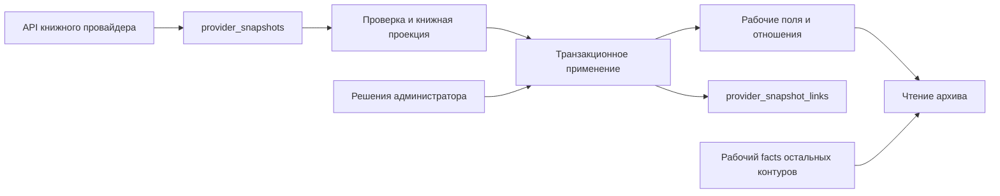

# Провайдеры и метаданные

Срез фактического кода: 20 октября 2026 года. Документ описывает реализованные пути, включая переходный книжный контур. Наличие миграций в репозитории не доказывает их применение или включение настроек в конкретной БД. Эксплуатационные команды и порядок книжного перехода находятся в [README проекта](../../README.md#исходные-снимки-книжных-провайдеров); жизненные циклы домена — в [WORKFLOWS](WORKFLOWS.md).

## Граница интеграции

Внешний источник предлагает сведения; опубликованная запись и редакционные решения принадлежат архиву. Общий интерфейс провайдера объединяет поиск записей, метаданные и обложки, но эти операции включаются и выполняются отдельно. Источник метаданных не обязан совпадать с источником выбранной обложки. Автоматическое обновление метаданных не заменяет обложку и основные редактируемые поля записи: общий job передаёт в сохранение `facts`, части и идентификатор источника, а не название или описание. Есть отдельные специализированные операции, например дополнение русских описаний аниме.

Источники: [типы контрактов](../../src/lib/covers/types.ts), [реестр](../../src/lib/covers/registry.ts), [обновление метаданных](../../src/lib/media/metadata-jobs.ts), [обложки](../../src/lib/covers/storage.ts).

| Медиа | Подключённые адаптеры |
|---|---|
| Фильмы, сериалы | TMDB |
| Аниме | Jikan, AniList, TMDB; Shikimori используется для дополнительного обогащения AniList |
| Книги | FantLab, Google Books, Open Library |
| Комиксы | Comic Vine |
| Игры | IGDB, RAWG |
| Roblox | Roblox |
| Настольные игры | BoardGameGeek |

Это перечень возможностей кода, а не перечень включённых интеграций конкретного окружения. Порядок, включение, `parallel`/`fallback`/`off` поиска записей и поиск обложек задаются административными настройками на пару «тип медиа + провайдер». Сначала выполняется параллельная группа; резервные источники вызываются последовательно, если первая группа ничего не нашла. Совпадения объединяются по `provider + externalId`, а не объявляются одной канонической записью разных провайдеров. Ключи API хранятся зашифрованными в БД; мастер-ключ шифрования остаётся конфигурацией развёртывания.

Источники: [подключения](../../src/lib/covers/providers.ts), [выбор источников](../../src/lib/covers/registry.ts), [настройки](../../src/db/queries/cover-settings.ts), [шифрование](../../src/lib/covers/credential-crypto.ts).

## Четыре разных слоя данных

| Слой | Смысл и владелец | Чего от него не следует ожидать |
|---|---|---|
| `provider_snapshots` | Полный ответ внешнего ресурса. Идентичность: провайдер, тип ресурса, внешний ID, метод API и хеш параметров запроса. Подключены книжный fetch-контур и профили авторов FantLab. | Это последний ответ на такой запрос, а не неизменяемая история версий и не универсальное хранилище ответов всех адаптеров. |
| `provider_snapshot_links` | Принадлежность сохранённого ответа доменной сущности, с назначением `primary` или `dependency`. | Полиморфная ссылка не имеет FK на запись или создателя. |
| Рабочие поля и отношения | `media_items`, язык `media_item_metadata.original_language`, связи жанров, платформ, создателей, их provenance и заявки. Содержат принятые решения архива. | Их нельзя заново строить с потерей ручного выбора при каждом сетевом ответе. |
| `media_item_metadata.facts` и `media_item_provider_snapshots` | Первый — действующий рабочий JSON для непереключённых книг и остальных типов. Второй — отдельная проекция выбранного импорта для проверки автомодерацией, одна на запись. | Проекция импорта не является полным raw-ответом; `facts` ещё нельзя удалить глобально. |

Схема: [schema.ts](../../src/db/schema.ts). Сохранение raw: [provider-snapshots.ts](../../src/db/queries/provider-snapshots.ts). Проекция импорта: [media-item-provider-snapshots.ts](../../src/db/queries/media-item-provider-snapshots.ts). Рабочие метаданные: [media-item-metadata.ts](../../src/db/queries/media-item-metadata.ts).

Raw не является зависимостью обычного отображения нормализованной книги. SQL-адаптер чтения строит совместимую форму `facts` из рабочих связей создателей и языка. Существующее имя поля в DTO поэтому не означает чтение старого JSON. Источник: [book-metadata.ts](../../src/db/queries/book-metadata.ts).

## Книги: получение и применение разделены

### Авторы FantLab

Авторы используют тот же `provider_snapshots`/`provider_snapshot_links` и тип job `provider.snapshots`: `entityType: "creator"`, `provider: "fantlab"`, необязательный `creatorIds`. Payload без `entityType` сохраняет книжную семантику. Дескриптор автора — `fantlab / author / externalId / autor.get / {biography:1,awards:1}`; полный ответ `GET /autor/{id}?biography=1&awards=1` сохраняется в JSONB, включая неизвестные поля. На авторах №1, №2 и №3 проверено: даты — `birthday`/`deathday`, биография — строка, награды — объект; без параметров оба раздела отсутствуют. Тестовые fixtures сохраняют полные проверенные ответы.

FantLab может вернуть HTTP 404 с полным JSON существующего автора и `is_opened=0`: это подтверждено на Кене Кизи, ID 10433, и сохранено отдельной fixture. Только snapshot-вызов по уже подтверждённой привязке допускает такой 404 после ограниченного чтения тела и проверки `autor_id`/`id`, `type=autor`, имени, допустимого `is_opened` и полноты запрошенных разделов. HTML, ошибка, чужой ID и неполный JSON не принимаются. Признак `is_opened=0` сохраняется в raw и диагностике; он не разрешает сменить внешнюю идентичность. Обычная проверка новых привязок и поиск по имени остаются строгими. Вариант имени в `provider_creator_mappings` и привязка ID в `provider_creator_bindings` — разные свидетельства одного Creator, а не две внутренние персоны; их нельзя автоматически сливать/удалять из-за одинаковой подписи в админке.

`refresh` получает и привязывает снимок, не меняя даты; `process` работает только с сохранённым ответом без сети; `refresh-process` совмещает этапы. Книжный `verify` для Creator запрещён. Выбирается только единственная активная подтверждённая привязка; отсутствие/неоднозначность требует ручного решения, поиск по имени не выполняется. Подтверждение заявки FantLab транзакционно создаёт отдельную job обогащения; сетевой сбой не откатывает уже созданного автора.

Маппер заполняет только пустые полные даты жизни персоны без исходящей связи псевдонима; имена, привязки, аватары и отношения не меняются. Перед применением под блокировкой Creator проверяются источник и `id + payloadHash`; даты, links, диагностика и checkpoint сохраняются атомарно с начальной/финальной проверкой lease. Используется общий Redis-слот FantLab с паузой минимум секунду, ограниченный транспорт, `Retry-After` и повторы средствами jobs. Возобновление использует снимок, полученный после создания job, если он уже сохранён.

Ручной бэкфилл доступен в общей админке снимков, отдельные операции — в карточке Creator. Партии имеют фиксированную верхнюю границу, keyset-курсор, ограниченные ошибки/диагностику и штатное отложенное продолжение. Массовая выборка читает уникальные Creator ID из активных привязок FantLab через частичный индекс `(provider, creator_id) WHERE active`, без `COUNT`, `OFFSET` и размножения строк при нескольких привязках. Явный набор ID выбирается по PK Creator. Даты не индексируются.

Для `refresh` и `refresh-process` доступен фильтр `onlyMissingSnapshots`: выбрать только Creator с активной привязкой, у которых отсутствует снимок точного дескриптора `fantlab / author / externalId / autor.get / {biography:1,awards:1}`. Проверка использует `NOT EXISTS` по существующему уникальному индексу снимков и не зависит от дат, биографии или других рабочих полей Creator, наличия snapshot links и давности ответа. Ответ другого метода, ресурса или с иными параметрами не считается подходящим снимком. Сохранённый полный raw пропускается даже до применения к Creator; для повторного извлечения полей из него используется `process` без сети. Фильтр несовместим с `process` и не меняет старые payload без этого признака.

Перед сетевой работой фильтрованный запуск сохраняет `checkpoint.retryId`: после сбоя между сохранением raw и применением текущий Creator остаётся в выборке до завершения попытки. Возобновление использует уже сохранённый снимок без повторного получения, а успешный commit атомарно очищает marker вместе с продвижением курсора. Новый запуск без такого marker пропускает сохранённый raw. Если поля Creator остались пустыми из-за отсутствия сведений у провайдера, этот режим не заставляет повторно загружать профиль.

Фильтр проверен через SQL/`EXPLAIN (ANALYZE, BUFFERS)` на 100 000 синтетических Creator, 300 000 привязок (две FantLab и одна другого провайдера на Creator), до 200 000 снимков. Без фильтра партия использует индекс активных привязок; при частых пропусках — индексный anti-join (около 0,5 мс для партии 26). При десяти оставшихся или полностью заполненном диапазоне план делает до 200 000 точечных проверок уникального индекса снимков: около 1,0–1,1 с локально. Возобновление с marker использует однопроходный hash-план, около 0,21 с. Повторных полных сканирований в коррелированных циклах нет, но поиск редких пропусков растёт с числом привязок; эти измерения не являются SLA продакшена. Новые индексы не потребовались. Сценарии и масштаб воспроизводятся в `tests/creator-provider-snapshots-runtime.test.ts`.

Проверка SQL на изолированной БД: 200 000 Creator, 840 000 привязок (по четыре других источника на Creator и по две FantLab у 10%), 10 000 связей псевдонимов, актуальная статистика `ANALYZE`. До/после индекса проверены обычная партия, редкий и отсутствующий результат: `Index Scan → Index Only Scan`, без общей сортировки; партия 26 Creator читает не более 52 строк FantLab. В измерении обычной партии время составило 0,197 → 0,080 мс, редкой 0,018 → 0,041 мс, отсутствующей 0,029 → 0,023 мс — эти локальные времена не являются SLA. Явные ID и состояние Creator используют PK; `pseudonym_of` — индекс первичного ключа связей; проверка привязки ограничена индексом Creator и локальной сортировкой его строк. Изменение даты проверено через `EXPLAIN` без исполнения. Обработка каждого Creator требует собственных проверок/транзакции; пакетная выборка не делает отдельных запросов на строки списка. Сеть и производственная нагрузка этими SQL-измерениями не моделируются.

Источники: [адаптер](../../src/lib/providers/creator-adapters.ts), [получение](../../src/lib/providers/creator-service.ts), [применение и выборка](../../src/db/queries/creator-provider-snapshots.ts), [общая job](../../src/lib/providers/snapshot-job.ts).

### Книжный контур

Для FantLab сохраняется ответ произведения `search-ids`, для Google Books — `volumes.get`, для Open Library — `works.get` и отдельные `authors.get`. Дескрипторы и внешние ID проверяются сервером; произвольный метод или URL из запроса не выполняется. Проверяется соответствие ресурса запрошенному ID и полнота состава авторов. Open Library требует все зависимые ответы; неполный комплект нельзя применить. Перенаправление объединённого произведения Open Library требует выбора нового источника в редакторе, а не скрытого переназначения локальной записи.

Ответ ограничен 2 МиБ. Валидный raw может сохраниться до получения всех зависимостей: это позволяет продолжить прерванный fetch, но наличие основного ответа ещё не означает готовность книги к обработке. Клиент получает ссылки `id + payloadHash`, а не raw JSON. Старый подписанный выбор без ссылок на снимки принимается только после серверного получения полного комплекта. При применении повторно проверяются хеши под блокировкой; ответ, изменившийся после открытия формы, не применяется молча.

Источники: [адаптеры](../../src/lib/providers/book-adapters.ts), [ограниченный fetch](../../src/lib/providers/book-fetch.ts), [комплекты и ссылки](../../src/lib/providers/book-service.ts), [совместимость старых форм](../../src/lib/providers/book-form-mutation.ts).

Сетевой запрос и транзакция применения разделены, чтобы не держать блокировку записи во время внешнего API. При применении `upsertMediaItemMetadata` проверяет действующую lease фоновой задачи, блокирует запись, проверяет ожидаемый источник и снимки. Рабочие изменения, provenance-ссылки и checkpoint книжной задачи фиксируются атомарно. Это защищает от запоздавшего worker и от результата HTTP для уже сменившегося источника. При сохранении raw выигрывает запрос с более поздним временем **начала** по часам БД; медленно завершившийся старый запрос не должен затереть новый.

Источники: [транзакция применения](../../src/db/queries/media-item-metadata.ts), [lease, порядок сохранения и ссылки](../../src/db/queries/provider-snapshots.ts).

Книжная нормализация сейчас отвечает прежде всего за авторов. Адаптеры возвращают `writer` и возможные поля для формы; издатели переносятся из существующего рабочего provenance, а до переключения — также из исторического JSON при том же провайдере. Это не универсальная нормализация всех библиографических полей. Подготовленная книжная проекция не очищает жанры и платформы: их состав она не предоставляет и не владеет им.

Источники: [BookProjection](../../src/lib/providers/types.ts), [издатели](../../src/db/queries/book-publisher-roster.ts), [сохранение](../../src/db/queries/media-item-metadata.ts).

### Контракт полей формы при переходе на снимки

Сохранение полного raw не доказывает сохранность данных в форме. Для выбора новой записи проверяется вся цепочка: raw → проекция → `MediaTitleMetadata.fields` при `enrichTitleFields` → форма. Поля формы — `title`, `originalTitle`, `releaseYear`, `description`; отсутствие, `null` и пустые значения в подробном ответе не очищают данные выбранного поискового результата. Выбор другого результата сначала сбрасывает поля по новому кандидату, поэтому значения прежней записи не переносятся. Фоновые jobs без `enrichTitleFields` по-прежнему не получают команду менять редакционные поля записи.

| Провайдер | Название | Оригинальное название в текущей форме | Год | Описание |
|---|---|---|---|---|
| FantLab | `name` / `work_name` / `title` | `name_orig` / `work_name_orig` | `year` / `work_year` | `description` |
| Google Books | `volumeInfo.title` | `volumeInfo.subtitle` — прежнее правило формы сохранено | год из `volumeInfo.publishedDate` | `volumeInfo.description` |
| Open Library | `title` | отдельного поля нет; сохраняется поисковое значение | год из `first_publish_date` | строка `description` или `description.value` |

При следующем подключении/переходе провайдера обязательны: fixture полного ответа с независимо заданными ожидаемыми полями, проверка обоих вариантов `enrichTitleFields`, offline replay, неполного ответа и смены кандидата; отдельно сохраняются существующие гарантии состава авторов/идентичности и ручных данных. Не выводить покрытие из наличия JSONB или только проверки `facts.authors`. [Контрактные тесты](../../tests/provider-title-fields-contract.test.ts) имеют исчерпывающие fixtures для `BookProviderCode`, а общие сценарии формы — для `MediaProviderCode`: новый код провайдера требует расширить проверку при typecheck. [Адаптеры](../../tests/provider-book-adapters.test.ts) проверяют также транспорт и библиографические связи.

Форматы внешних полей: [Google Books Volume](https://developers.google.com/books/docs/v1/reference/volumes), [Open Library JSON API](https://openlibrary.org/dev/docs/api/books).

## Переключение источника истины книг

Получение raw для трёх книжных провайдеров уже встроено в обычный путь. Переход **чтения и записи рабочих метаданных** управляется отдельно: `provider_settings.normalized_book_metadata` для каждого провайдера. Значение по умолчанию — выключено; фактические значения окружения в этом аудите не проверялись.

До включения совместимый книжный `facts` продолжает обновляться; после включения прежний persisted JSON замораживается, новые применения требуют валидного комплекта снимков, а чтение собирает авторов/издателей/язык из рабочих данных. Ручные участники входят в рабочую проекцию вместе с принятыми импортированными участниками. Переключатель односторонний: замороженный JSON после новых импортов больше не пригоден как безопасный источник отката.

Включение выполняет проверку под блокировкой строки настройки. Проверяется связь с основным raw, корректность ID, перенос языка, авторов и издателей, позиции provenance, внешние ID FantLab, отсутствие содержательных не перенесённых полей. Учитываются исключения и вручную переоткрытые заявки. Импорт держит совместную блокировку той же настройки до commit, чтобы переключение не обогнало запись в старый слой. Это проверка готовности данных, а не обещание сохранности любого произвольного ключа `facts`.

Источники: [переключение](../../src/lib/providers/book-cutover.ts), [проверка готовности](../../src/lib/providers/book-cutover-check.ts), [совместимое чтение](../../src/db/queries/book-metadata.ts). Конкретный rollout — в [README](../../README.md#исходные-снимки-книжных-провайдеров).

## Обновление, обработка и бэкфиллы

Разовая задача `provider.snapshots` работает по известным источникам книг; она не ищет соответствия по названию.

| Операция | Сеть | Изменение рабочих данных |
|---|---|---|
| `refresh` | Получить комплект raw | Нет; привязать доказательства к записи |
| `process` | Нет | Применить сохранённый комплект |
| `refresh-process` | Получить комплект | Применить комплект |
| `verify` | Нет | Нет; сравнить старых авторов с проекцией источника |

`verify` не равен полной проверке готовности cutover: это более узкое сравнение, которое может показать несовпадение имён даже при осознанном ручном решении. Массовая задача фиксирует верхнюю границу ID, курсор и счётчики, повторяет временную ошибку отдельной записи до трёх раз, затем сохраняет её ошибку и продолжает обход. Лимиты откладывают выполнение через штатный defer; при возобновлении используются ответы, полученные не раньше создания этого запуска. Хранятся последние 100 ошибок, а общий счётчик ошибок не ограничен этим числом. Для повторной обработки ошибок нужен новый запуск с нужными ID или диапазоном.

Источники: [handler](../../src/lib/providers/snapshot-job.ts), [payload/checkpoint](../../src/lib/providers/snapshot-job-payload.ts), [узкое сравнение](../../src/lib/providers/snapshot-report.ts), [диагностика](../../src/lib/providers/snapshot-item-errors.ts).

Другие контуры сохраняются отдельно:

- Общий `media.metadata-backfill` берёт записи с отсутствующими метаданными; при известном источнике обращается по ID, иначе ищет и ранжирует кандидатов. По умолчанию обрабатываются опубликованные записи, размер выборки ограничен. `force`, фильтр типа и режим только частей задают отдельный охват. `media.metadata-refresh` автоматически выбирает устаревшие метаданные только сериалов и аниме, а не всех типов. [Выборка](../../src/db/queries/media-item-metadata.ts), [backfill](../../src/lib/media/metadata-backfill.ts), [общая логика](../../src/lib/media/metadata-jobs.ts).
- Части сериалов TMDB синхронизируются вместе с метаданными; клиентский кандидат не считается доверенным списком частей. При выборе источника создаётся дополнительный fetch частей; загрузка постеров вынесена в отдельные jobs. [Точка координации](../../src/db/queries/media-item-metadata.ts), [синхронизация частей](../../src/db/queries/title-parts-sync.ts).
- Shikimori через AniList дополняет русские aliases и подходящее для обновления описание. Решение заново вычисляется по текущим данным под блокировкой; при достижении лимита aliases ради русского варианта может заменяться последний alias. Это специализированный путь редактирования основных полей, не обычный metadata refresh. [Политика](../../src/lib/media/anime-shikimori-backfill-core.ts), [применение](../../src/db/queries/anime-shikimori-backfill.ts).
- Игровой бэкфилл имеет собственную операцию, checkpoint каждой записи, сохранённый полный roster компаний и кеш профилей. IGDB запрашивается пакетами, RAWG — по записи. Источник повторно проверяется после сети и под блокировкой; затем roster синхронизируется и безопасные заявки могут автоодобряться. [Handler](../../src/lib/creators/game-company-backfill.ts), [постоянный прогресс](../../src/db/queries/game-company-backfill.ts).
- BGG-бэкфилл добавляет технические `bggCreators`, сохраняет редактируемые поля и выполняет отдельный автоапрув. `dryRun` не меняет доменные данные, но обращается к API и пишет отчёт. Продолжение создаётся новой задачей с курсором; ошибки отдельных записей остаются в журнале. [Handler](../../src/lib/creators/bgg-backfill.ts). Ограничения интеграции, кеш и права использования — в [BGG](../integrations/bgg.md).

## Создатели: идентичность, состав и изображения

Имя внешнего участника, подтверждённая идентичность и участие в записи — разные вещи. `provider_creator_mappings` сопоставляет нормализованное имя; `provider_creator_bindings` закрепляет внешний ID за каноническим создателем. `entry_creator_sources` хранит основания участия с ролью и позицией; `entry_creators.is_manual` защищает ручное участие при очистке импортированного состава. Заявки и исключения — самостоятельные долговременные решения: повторный импорт не должен заново автоматически одобрять вручную переоткрытое или исключённое соответствие.

FantLab с ID разрешается по binding; совпадение имени не выбирает и не заменяет создателя. Состав с неполностью разрешённой идентичностью не должен стирать прежний provenance целиком. BGG и игровые компании также имеют специализированные ID-пути. Для RAWG `developer:<id>` и `publisher:<id>` различны; у IGDB идентификатор компании `company:<id>` может участвовать в разных ролях. У книжных провайдеров без закреплённой идентичности действует путь именных соответствий, с заявками на неизвестные значения.

Источники: [координатор](../../src/db/queries/creator-requests.ts), [FantLab и издатели](../../src/db/queries/book-contributors.ts), [BGG](../../src/db/queries/bgg-creators.ts), [компании игр](../../src/db/queries/game-companies.ts), [prune](../../src/db/queries/creators.ts).

Миграция старых FantLab-вариантов имени в binding и синхронизация аватарки — отдельные разовые задачи. Первая требует единственного точного совпадения всех вариантов с одним ID, проверки карточки и отсутствия другого владельца ID. Вторая не заменяет ручной аватар, требует подтверждённой привязки, проверяет версию при commit и удаляет неиспользованный загруженный объект при конфликте. Профили и изображения игровых компаний имеют свой кеш и процедуру обогащения; это не общий книжный raw-контур.

Источники: [FantLab-sync](../../src/lib/creators/fantlab-sync.ts), [jobs](../../src/lib/creators/fantlab-jobs.ts), [версионирование аватаров](../../src/db/queries/creator-avatars.ts), [игровые профили](../../src/lib/creators/game-company-images.ts).

## Жанры, платформы и лимиты — общие зависимости

Метаданные не создают канонические жанры и платформы напрямую. Внешние значения разрешаются через соответствия, а неизвестные значения попадают в заявки с occurrences записей. Рабочие provider-связи и ручные решения хранятся отдельно. Поэтому обновление одного источника может породить модерацию в нескольких подсистемах. Общий порядок блокировок в metadata upsert: запись → ключи заявок жанров → ключи заявок платформ; произвольно менять его опасно.

Источники: [metadata upsert](../../src/db/queries/media-item-metadata.ts), [жанры](../../src/db/queries/media-item-genres.ts), [платформы](../../src/db/queries/media-item-platforms.ts). Отдельный rollout платформ описан в [существующем документе](../data/platform-rollout.md).

Счётчики лимитов распределены через Redis, но единица учёта неодинакова:

- Общий лимитер считает допуск операции адаптера; авторские ограничения проверяются отдельно. При недоступности Redis запросы с такими ограничениями возвращают ошибку проверки, а фоновые процессы откладываются.
- Книжный raw-fetch резервирует квоту на каждый HTTP, включая зависимых авторов Open Library; фоновый fetch сохраняет резерв 100 запросов.
- IGDB/RAWG считают HTTP на транспортной границе, с общими суточными, секундными, конкурентными ограничениями и cooldown по `Retry-After`. При недоступном Redis транспорт закрыт. Игровой бэкфилл также оставляет резерв 100 запросов.
- FantLab дополнительно имеет распределённый слот запроса; BGG — собственные кеш, leases и минимальный интервал, описанные в его интеграционном документе.
- Relay превью изображений допускает запрос при временной недоступности своего Redis-лимитера: это осознанно иное поведение, чем у платного/ограниченного API.

Источники: [общий лимитер](../../src/lib/covers/rate-limits.ts), [книжные HTTP](../../src/lib/providers/book-fetch.ts), [игровой бюджет](../../src/lib/covers/game-provider-budget.ts), [FantLab transport](../../src/lib/creators/fantlab-api.ts), [BGG runtime](../../src/lib/covers/providers/bgg-runtime.ts).

## Обложки и границы хранения

Выбранный внешний кандидат подписывается сервером, загружается через provider-specific relay с allowlist, проверяется по типу и размеру и копируется в S3/MinIO. Ручной файл имеет приоритет над выбранным кандидатом в одной отправке формы. Оригинал и миниатюра хранятся отдельно; сбой миниатюры не делает успешную загрузку оригинала неуспешной. Есть отдельный бэкфилл миниатюр. Изменение БД и загрузка объекта не образуют одну ACID-транзакцию, поэтому код использует компенсационное удаление, а не обещает атомарность двух хранилищ.

Источники: [storage](../../src/lib/covers/storage.ts), [relay](../../src/lib/covers/provider-image-relay.ts), [thumbnail backfill](../../src/lib/covers/thumbnail-backfill.ts). Формы и server actions отвечают за очистку файлов при неуспешном сохранении записи.

## Ограничения и направления упрощения

1. **Переходная сложность уже существует:** два типа снимков, legacy/normalized чтение книг и несколько identity-путей создателей. Удалять их можно только после завершения rollout и проверки оставшихся читателей. Успешное получение raw само по себе не завершает миграцию `facts`.
2. **Raw не даёт исторической воспроизводимости:** snapshot обновляется на месте, а link хранит ID, не применённый хеш. После `refresh` рабочие данные могут соответствовать предыдущему payload. Это ожидаемо при разделении refresh/process, но важно для расследования происхождения данных.
3. **Издатели книг пока не извлекаются новым адаптером:** повторная обработка переносит существующий roster. Нельзя считать её полной пересборкой библиографии из raw.
4. **Бэкфиллы неодинаково возобновляются:** книжный процесс имеет checkpoint и ограниченный список ошибок, игровой — постоянные строки операции, BGG/FantLab — цепочку задач и журнал. Унифицировать стоит только после выбора нужных гарантий повторения и отчётности.
5. **Суточная статистика разных провайдеров несопоставима по HTTP:** изменение общего механизма не должно повторно учитывать IGDB/RAWG или забыть зависимые книжные запросы.

Общие приоритеты рисков и условия удаления механизмов находятся в [TECH_DEBT](TECH_DEBT.md). Аудит не выполнял живые API, jobs, миграции и SQL; состояние rollout, полнота production-данных и фактическая пропускная способность не подтверждены.
