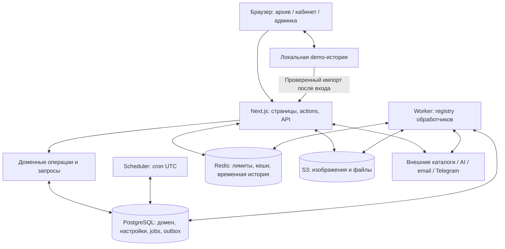

# Архитектура Zadrotto / «Гикотеки»

Аудит рабочего дерева от **20 октября 2026 года**. Документы описывают реализацию, включая находящиеся в рабочем дереве изменения книжных снимков и миграции `0127–0128`. Применение миграций, реальные настройки, состояние production и доступность внешних API не проверялись. Это архитектурный аудит исходников, а не нагрузочное тестирование или аудит безопасности.

## Как читать

| Документ | На какой вопрос отвечает |
| --- | --- |
| [DATA_MODEL](DATA_MODEL.md) | Что является сущностью, кому принадлежат данные, какие связи и источники истины существуют? |
| [PROVIDERS](PROVIDERS.md) | Как внешний ответ становится рабочими данными и что происходит при повторной обработке? |
| [WORKFLOWS](WORKFLOWS.md) | Какие шаги, транзакции и фоновые реакции проходят пользовательские и административные действия? |
| [INVARIANTS](INVARIANTS.md) | Какие гарантии требуется сохранить при изменении системы? |
| [P1_RELIABILITY](P1_RELIABILITY.md) | Как защищены leases/recovery и как выкладывать исправления? |
| [TECH_DEBT](TECH_DEBT.md) | Какие ограничения уже есть, что можно упростить и какие решения остаются за владельцем? |

Продуктовый смысл и границы MVP находятся в [PROJECT_CONTEXT](../../PROJECT_CONTEXT.md), запуск и эксплуатационные команды — в [корневом README](../../README.md). Настоящий комплект связывает эти материалы с кодом, не заменяет инструкции по развёртыванию.

## Устройство системы

Приложение устроено как **монолит Next.js с отдельными процессами scheduler и worker и общей PostgreSQL**. Это описание фактической структуры, не заявленная микросервисная архитектура. Публичные страницы, кабинет автора, админка, server actions и HTTP endpoints живут в одном приложении. Доменные операции выполняются в `src/db/operations` и `src/db/queries`; `queries` содержит также записи и бизнес-переходы, поэтому название каталога не означает read-only слой. Общая схема находится в [schema.ts](../../src/db/schema.ts), соединение Drizzle — в [db/index.ts](../../src/db/index.ts), процессы и зависимости — в [docker-compose.yml](../../docker-compose.yml).

Основные технологические зависимости: Next.js 16, React 19, TypeScript, Drizzle/PostgreSQL, Redis и S3-совместимое хранилище. У очереди нет отдельного брокера: `jobs` и `job_runs` хранятся в PostgreSQL. Redis не является хранилищем оценок, снимков или очереди. [Зависимости](../../package.json), [очередь](../../src/lib/jobs/queue.ts), [scheduler](../../src/lib/jobs/scheduler.ts).

## Доменные подсистемы

| Подсистема | Ответственность и связи | Основная реализация |
| --- | --- | --- |
| Архив | Общая запись `media_items`, тип, носитель, названия, описание, части, видимость. Атрибуция создавшего автора не равна владению опубликованной записью. | [media-items](../../src/db/queries/media-items.ts), [author-media-items](../../src/db/operations/author-media-items.ts), [title-parts](../../src/db/queries/title-parts.ts) |
| Серии и редакционные подборки | `franchises` — серии с иерархией; членство записи модерируется отдельно. Редакционные подборки используют блочный документ; серия задаётся отношениями архива. | [franchises](../../src/db/queries/franchises.ts), [editorial-collections](../../src/db/queries/editorial-collections.ts), [editorial-documents](../../src/db/queries/editorial-documents.ts) |
| Создатели | Люди, коллективы и организации, роли в записи, псевдонимы, связи с сериями и внешние идентичности. Провайдерные составы синхронизируются с сохранением ручных решений. Фильмы и сериалы TMDB используют общие организации/person; у сериалов отдельно связаны вещатели, создатели и явные шоураннеры. | [creators](../../src/db/queries/creators.ts), [creator-requests](../../src/db/queries/creator-requests.ts), [game-companies](../../src/db/queries/game-companies.ts) |
| Унификация | Жанры и платформы — внутренние справочники. Provider mapping, исключения и заявки связывают внешние значения с внутренними; решение распространяется фоном. | [genres](../../src/db/queries/genres.ts), [genre-requests](../../src/db/queries/genre-requests.ts), [platform-requests](../../src/db/queries/platform-requests.ts) |
| Провайдеры | Адаптеры поиска, метаданных и изображений; подтверждённое происхождение импорта; raw snapshots книг; обновление и бэкфиллы. Новый книжный pipeline сосуществует с legacy `facts`. | [реестр](../../src/lib/covers/registry.ts), [book-service](../../src/lib/providers/book-service.ts), [metadata-refresh](../../src/lib/media/metadata-refresh.ts) |
| Личный архив | Оценки записи и её частей, статусы `wanted/skipped`, опыт знакомства с датой и точностью, рецензии и реакции. Это отдельные пользовательские данные, а не поля общей записи. | [ratings](../../src/db/queries/ratings.ts), [statuses](../../src/db/queries/author-media-statuses.ts), [experiences](../../src/db/queries/author-media-experiences.ts), [reviews](../../src/db/queries/contribution-reviews.ts) |
| Модерация и доверие | Заявки записей, серий, связей и рецензий; профили доступа; правила автоодобрения; XP и trust через журнал действий. Нет одного универсального статуса для всех этих процессов. | [contributions](../../src/lib/contributions/model.ts), [access-profiles](../../src/db/queries/author-access-profiles.ts), [automoderation](../../src/lib/automoderation/media-policy.ts), [reputation](../../src/lib/reputation/service.ts) |
| Событийные реакции | Доменный факт и outbox в бизнес-транзакции; обработчики ачивок, уведомлений, автомодерации и репутации. Внешняя доставка использует отдельные outbox. | [transaction](../../src/db/transaction.ts), [registry](../../src/lib/domain-events/registry.ts), [dispatcher](../../src/lib/domain-events/dispatcher.ts) |
| Другие пользовательские механизмы | Дружба по запросу, публичные профили и журналы, викторины с участием и попытками, багрепорты с административными переходами. | [friends](../../src/db/queries/friends.ts), [quizzes](../../src/db/queries/quizzes.ts), [bug-reports](../../src/db/queries/bug-reports.ts) |
| Эксплуатация | Настройки в БД, activity log, журнал jobs, диагностика сервисов, CSV-экспорт и приватный dump БД. | [jobs](../../src/db/queries/jobs.ts), [activity-logs](../../src/db/queries/activity-logs.ts), [admin-exports](../../src/lib/admin-exports/generate.ts), [health](../../src/lib/services/health.ts) |

«Пользовательская коллекция» в текущем продукте — личная история, статусы, оценки и фильтры архива. Произвольный пользовательский список с собственными элементами не следует путать с `editorial_collections`: это административно управляемая редакционная сущность. Состав личного состояния виден в [demo-profile](../../src/lib/user-state/demo-profile.ts) и [схеме](../../src/db/schema.ts).

## Доступ и пользовательские режимы

У автора есть отдельные профиль, учётная запись, email/identity, challenge и серверная сессия. Вход возможен по access token или через учётную запись. Cookie автора содержит случайный opaque token; в БД находится его hash, срок и отзыв. Cookie администратора содержит HMAC-подписанный JWT, но каждый запрос дополнительно сверяет администратора и `sessionInvalidatedAt` в БД. Это две разные реализации, а не единая ролевая сессия. [Author auth](../../src/lib/auth/author-auth.ts), [операции регистрации](../../src/db/operations/author-auth.ts), [admin auth](../../src/lib/auth/admin-auth.ts), [admin token](../../src/lib/auth/admin-session.ts).

Режимы `plain`, `demo`, `authorized` имеют разную ответственность. Demo хранится в версионированном `localStorage`, не создаёт серверного автора и не даёт прав. Настоящий автор имеет приоритет. После входа сервер повторно проверяет demo и переносит только свободные позиции доступных опубликованных записей; повтор не должен дублировать оценки и доменные эффекты. [Режим](../../src/lib/user-state/mode.ts), [парсер](../../src/lib/user-state/demo-profile.ts), [импорт](../../src/db/operations/demo-profile-import.ts).

Видимость записи и доступ к её типу — разные проверки. `isPubliclyAvailable`, разрешение гостям и grants профиля доступа определяют доступные типы; личные предпочтения автора определяют включённые типы внутри доступных. Скрытие типа из предпочтений не является отзывом права. [media-types](../../src/db/queries/media-types.ts).

## Неочевидные связи

- **Метаданные влияют не только на карточку.** Импорт запускает согласование жанров, платформ, создателей, частей, названий и серий; решения по заявкам затем пересобирают локальные связи. Для книг переключение источника чтения затрагивает также поиск, выгрузки и AI-контекст. См. [PROVIDERS](PROVIDERS.md).
- **Редакционная ссылка ограничивает изменения архива.** Одиночный блок и элемент `entry_group` считаются равноправными ссылками. Сохранение документа подборки проверяет опубликованность записей под блокировкой; проверка ссылок используется при изменении записи. Это влияет на жизненный цикл записи, а не только на группировку в интерфейсе. [Запись блоков](../../src/db/queries/editorial-documents.ts), [reference SQL](../../src/db/queries/editorial-document-references.ts).
- **Иерархия серий участвует в классификации.** Косвенное членство и жанры, заменяемые серией, меняют фильтрацию и представление; связь записи с серией имеет собственную модерацию. См. [DATA_MODEL](DATA_MODEL.md).
- **Оценки частей меняют общую проекцию.** При отсутствии общей оценки используется вычисленный результат частей; итоговая статистика и demo должны следовать одному правилу, а не записывать вычисленный результат как авторскую общую оценку. [Правило](../../src/lib/media/title-parts.ts), [SQL-проекция](../../src/db/queries/effective-ratings.ts).
- **Выдача побочных результатов асинхронна.** Успех пользовательской транзакции не означает немедленную выдачу ачивки, обновление trust или доставку уведомления. Требуются worker и recovery; новый consumer не переигрывает уже доставленную историю автоматически. См. [WORKFLOWS](WORKFLOWS.md).
- **Redis допускает разные отказы.** Временная история просмотров теряется без ущерба основным данным; проверки лимитов могут блокировать внешние операции при недоступности Redis. В Compose Redis без persistence, поэтому перезапуск обнуляет также счётчики и кеши. [recently-viewed](../../src/lib/main-page/recently-viewed.ts), [rate-limits](../../src/lib/rate-limits/redis.ts), [Compose](../../docker-compose.yml).

## Вспомогательные возможности и границы

AI выделен в адаптеры OpenRouter/DeepSeek и каталог сценариев: подбор серий и редакционные справки. Сценарий наследует модель/параметры провайдера с явными переопределениями; structured output повторно валидируется сервером. AI не принимает решения о канонической идентичности записей. Для BGG отключены AI-справки и подбор серий для настолок; узкое исключение разрешает локализацию имён персон по имени, роли и названию игры. Остальные материалы BGG в ИИ не передаются. Справка хранится отдельно от исходного описания, учитывает hash контекста, ручной lock и конкурентное изменение источника. [Каталог](../../src/lib/ai/scenarios/catalog.ts), [service](../../src/lib/ai/service.ts), [summary flow](../../src/lib/media/editorial-summary-flow.ts), [ограничения BGG](../integrations/bgg.md).

Изображения хранятся отдельно от реляционной модели: ключ объекта либо допустимый URL находится в БД, байты — в S3; для отдельных категорий работают серверные маршруты выдачи. PostgreSQL и S3 не образуют общую транзакцию. Визуальный носитель — классификация и оформление записи, не отдельная основная сущность произведения. [Storage](../../src/lib/services/minio.ts), [обложки](../../src/lib/covers/storage.ts), [носители](../../src/db/queries/media-carriers.ts).

Поиск использует общую нормализацию пробелов, регистра и `ё/е`, с соответствующим SQL-выражением и trigram-индексами в миграциях. Это поиск по хранимым названиям/aliases и справочникам, а не отдельный поисковый сервис. Масштабируемость конкретного запроса нужно проверять отдельно по фактическому выражению и плану. [JS](../../src/lib/search/normalize.ts), [SQL](../../src/db/search.ts).

## Граница достоверности аудита

Изучены схема и связанные ограничения миграций, основные операции и запросы домена, реестры интеграций/jobs/событий, фоновые обработчики, пользовательские режимы, конфигурация процессов и релевантные тесты. Это обзор всех значимых подсистем с углублением в жизненные циклы и целостность, а не построчная проверка каждого компонента или endpoint. Утверждения о механизмах привязаны к исходникам; продуктовые ограничения отделены от обнаруженного долга в [TECH_DEBT](TECH_DEBT.md).

Не выполнялись миграции, запросы к прикладной БД, внешние импорты, сборка production или замеры нагрузки. Следовательно, здесь нет подтверждения скорости на большом объёме данных, состояния очередей, включения задач или завершённости бэкфиллов. Диаграммы показывают логические связи, не исчерпывающий перечень FK.
