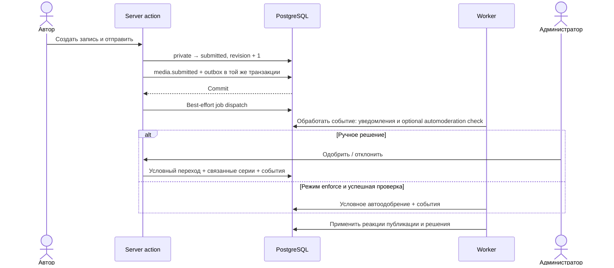

# Жизненные циклы

Проверено по реализации 20 октября 2026 года. Здесь описаны границы транзакций и асинхронных реакций; модель сущностей — в [DATA_MODEL.md](DATA_MODEL.md), подробности источников — в [PROVIDERS.md](PROVIDERS.md), ограничения — в [INVARIANTS.md](INVARIANTS.md). Наличие обработчика или миграции с расписанием не доказывает, что конкретная задача включена в работающем окружении: это состояние таблицы `jobs`.

## 1. Добавление и публикация записи

Автор создаёт `private`-запись; административное создание сразу публикует запись. Отправка автором переводит только собственную запись из `private`/`rejected` в `submitted` либо непосредственно в `published`: выбор зависит от разрешений автора в server action. При отправке на проверку растёт `moderation_revision`, поэтому повторная отправка представляет новую проверяемую редакцию. Отзыв из `submitted` возвращает `private`; редактирование и удаление автором ограничены состояниями черновика/отказа.

Администратор принимает решение только для ещё `submitted`-записи условным обновлением. В той же транзакции он меняет статус предложенных этим же автором серий, связанных с записью. Одобрение удаляет временный `media_item_provider_snapshots`, создаёт `media.published` и, если известен автор вклада, `media.approved`; отказ создаёт `media.rejected`. Изменение записи и события атомарны, но реакции потребителей происходят позже. Опубликованная запись становится частью общего архива: автор вклада не получает право владеть публичным объектом.

Источники: [media actions](../../src/app/author/(protected)/media/actions.ts), [create/submit/review в media-items](../../src/db/queries/media-items.ts), [transaction wrapper](../../src/db/transaction.ts).



## 2. Автомодерация

Режим берётся из `archive_settings`: `off`, `shadow` или `enforce`. Consumer `media.submitted` сверяет текущий статус и редакцию, сохраняет fingerprint входа и проверку, создаёт `job_run` в своей транзакции. Проверка читает **временный снимок предложения** `media_item_provider_snapshots`, а не универсальный `provider_snapshots`: сходные названия скрывают разные назначения.

Политика проверяет совпадение полей со снимком, отсутствие пользовательских альтернативных названий, неопубликованных серий, подозрительного текста и кандидатов в дубли; повторно обращается к провайдеру для проверки доступности и идентичности внешнего объекта. Свежий ответ не используется для полного повторного сравнения всех полей. Это консервативный набор условий автоодобрения, не универсальная содержательная модерация.

В `shadow` сохраняется решение без публикации; `NEEDS_REVIEW` оставляет ручной разбор. В `enforce` автоодобрение дополнительно требует прежние `moderation_revision` и `updated_at`, статус `submitted` и отсутствие неопубликованных серий. Изменённая запись делает проверку `stale`. Успех атомарно публикует запись, завершает check, удаляет снимок предложения и создаёт события публикации, одобрения и автоодобрения.

Восстановление сохраняет одну попытку: существующий jobs recovery завершает осиротевшую проверку как completed / NEEDS_REVIEW. Все записи проверки и approval используют token/lease job; queued/running запуски предотвращают ложное обнаружение сироты, терминальные результаты сохраняются. [Подробности и тесты](P1_RELIABILITY.md).

### Серии и их связи с записями

Предложение новой серии вместе со связью, добавление записи к существующей серии и запрос удаления связи — разные операции с отдельной модерацией. Публикация самой серии не означает автоматическое одобрение всех предложений связей; при ручной модерации записи отдельно действует описанное выше правило для её новых серий того же автора. Изменение иерархии серии сериализуется глобальной advisory-блокировкой, проверяет циклы и допустимую глубину и удаляет избыточные прямые связи с предками, если остаётся связь с потомком. Публичное членство в серии вычисляется общим рекурсивным helper: перенос серии может изменить каталог и прогресс ачивок, даже если запись не редактировалась. Источники: [franchises](../../src/db/queries/franchises.ts), [series membership](../../src/db/queries/series-membership.ts), [achievement consumer](../../src/lib/achievements/consumer.ts).

## 3. Импорт, обновление и повторная обработка метаданных

Поиск обращается к включённым провайдерам с их порядком и fallback, а сохранение выбранного результата отделено от поиска. Для книг загрузчик сохраняет сырые ответы провайдеров и зависимости; применение нормализованных данных выполняется под блокировками записи, источника и снимков, с проверкой, что источник не был изменён за время сети. Внешний HTTP-вызов не включён в долгую транзакцию записи.

`provider.snapshots` разделяет режимы: `refresh` получает и сохраняет снимки без изменения рабочих данных; `process` повторно применяет сохранённые снимки без сети; `refresh-process` делает оба этапа; `verify` сравнивает нормализованный результат, но не является проверкой готовности cutover. Продвижение курсора и checkpoint позволяют продолжить диапазон, а исчерпание квоты откладывает работу. Legacy-адаптеры, game/BGG/Fantlab-бэкфиллы имеют отдельные протоколы; их нельзя считать вариантами одного универсального импорта.

Заявки на унификацию создателей, жанров и платформ сохраняют решение отдельно от его массового применения. Фоновое применение повторно синхронизирует затронутые записи; ручные связи, исключения и вновь открытые заявки ограничивают разрешённые изменения. Синхронизация может завершиться позже административного решения.

Подробные схемы источников, checkpoint, cutover и приоритетов — в [PROVIDERS.md](PROVIDERS.md). Опорный код: [cover registry](../../src/lib/covers/registry.ts), [metadata apply](../../src/db/queries/media-item-metadata.ts), [snapshot job](../../src/lib/providers/snapshot-job.ts), [creator requests](../../src/db/queries/creator-requests.ts).

## 4. Доменное событие и доставка реакций

Это transactional outbox, а не event sourcing: рабочие таблицы остаются источником текущего состояния, каталог событий содержит ограниченный набор значимых переходов. `runInDomainEventTransaction` сохраняет business change, `domain_events` и `domain_event_outbox` в одной транзакции. После commit он пытается создать immediate job; ошибка этой попытки логируется и не отменяет уже сохранённое действие.

Dispatcher блокирует outbox-строку, проверяет тип события, затем в **одной транзакции на событие** исполняет текущих потребителей: ачивки, уведомления, автомодерацию и репутацию. Уникальная пара `(event_id, consumer_key)` защищает DB-эффекты от повторной доставки; claim потребителя и его DB-эффекты коммитятся вместе. `dispatched_at` выставляется после всех реакций. Поэтому ошибка одного потребителя откатывает и остальные реакции этого события.

```mermaid
sequenceDiagram
    participant B as Бизнес-операция
    participant DB as PostgreSQL
    participant W as Dispatcher
    participant C as Consumers
    B->>DB: BEGIN: изменение + event + outbox
    DB-->>B: COMMIT
    B->>DB: Immediate job (best effort)
    W->>DB: Lock outbox; прочитать event
    loop Подходящие consumers
        W->>DB: INSERT consumption ON CONFLICT DO NOTHING
        W->>C: handle(tx, event), если claim получен
        C->>DB: DB-эффекты и возможные новые события
    end
    W->>DB: dispatched_at + COMMIT
    W->>DB: Best-effort jobs новых событий / внешней доставки
```

Периодический recovery выбирает старейшие pending события и продолжает текущий батч после отдельной ошибки. Это страхует потерянную immediate job, но требует включённого расписания и живых scheduler/worker. Recovery выбирает готовые события по next_attempt_at/event_id, сохраняя 60-секундную отсрочку до consumers. Ошибки остаются pending и отображаются в activity log и failed-запусках. [Границы backoff](P1_RELIABILITY.md#продвижение-событий-и-диагностика). Новый consumer автоматически не воспроизводит уже dispatched историю — ему нужен специализированный backfill.

Источники: [transaction wrapper](../../src/db/transaction.ts), [persistence](../../src/lib/domain-events/persistence.ts), [dispatcher](../../src/lib/domain-events/dispatcher.ts), [registry](../../src/lib/domain-events/registry.ts), [best-effort enqueue](../../src/lib/domain-events/queue.ts), [seed recovery](../../drizzle-archive/pre-baseline/0060_domain_events_achievements.sql).

## 5. Фоновые задачи и ограничения API

Очередь хранится в PostgreSQL, в `jobs` и `job_runs`. Redis обслуживает ограничения запросов; BullMQ в этом механизме не используется. Scheduler выбирает включённые просроченные расписания через `FOR UPDATE SKIP LOCKED`, создаёт запуск и продвигает `next_run_at` в одной транзакции. Следующее время считается от текущего момента: все пропущенные интервалы после простоя не воспроизводятся.

Worker последовательно исполняет один claimed job за итерацию; несколько процессов могут безопасно разбирать очередь. Claim увеличивает attempts и выдаёт `lock_token` с lease до timeout. Запись успеха, отказа, defer и retry проверяет этот token. Retry использует ограниченную экспоненциальную задержку; defer откладывает запуск без расходования попытки. Recovery возвращает просроченные leases в очередь либо завершает их ошибкой при исчерпании попыток. Политики по умолчанию — три попытки, timeout 300 секунд, задержки 60…3600 секунд; обработчики и расписания могут их менять.

Администратор может остановить ожидающий запуск, а для `provider.snapshots` — также выполняющийся: кнопка доступна в ходе обработки и журнале. Остановка атомарно устанавливает `cancelled` и отзывает lease/token. Уже сохранённые результаты и checkpoint остаются; последующие записи старого worker блокирует транзакционный guard. Worker снимков проверяет владение раз в секунду и при его потере прерывает текущий HTTP-запрос через `AbortSignal`. После выкладки только веб-приложения старый worker может закончить текущий запрос, но не сохранить его результат. Остановка не откатывает завершённые изменения.

Timeout подаёт `AbortSignal`, но не принудительно останавливает JavaScript/SQL. Lease не продлевается heartbeat. Обработчик обязан кооперативно отменять сеть и проверять владение перед критическими записями: token защищает состояние самой очереди, а не автоматически все доменные эффекты. Мутации, checkpoints и продолжения обработчиков защищены существующим транзакционным guard с финальной проверкой срока; CSV также учитывает signal и публикуется под уникальным ключом попытки. [Охват](P1_RELIABILITY.md#владение-выполнением).

Ограничения провайдеров хранятся в БД и исполняются счётчиками Redis с фиксированными окнами. Авторские квоты на несколько окон проверяются атомарным Lua-скриптом; провайдерные лимиты имеют собственные транспортные особенности. IGDB/RAWG учитывают реальные HTTP-запросы на транспортной границе, а не общий search callback. Проверка остатка для `quotaReserve` и фактическая резервация разделены, поэтому это мягкий резерв при конкуренции. Недоступность Redis блокирует ограничиваемый поиск, но image relay намеренно допускает показ preview при сбое счётчика.

Источники: [scheduler runtime](../../src/jobs/scheduler.ts), [worker runtime](../../src/jobs/worker.ts), [queue queries](../../src/db/queries/jobs.ts), [execution](../../src/lib/jobs/worker.ts), [handlers](../../src/lib/jobs/handlers.ts), [policies](../../src/lib/jobs/model.ts), [API limits](../../src/lib/covers/rate-limits.ts), [Redis implementation](../../src/lib/rate-limits/redis.ts).

### Проверка и восстановление обложек

Ручная задача `media.covers-reconcile` доступна в общих разовых операциях, без расписания.
`audit` по умолчанию проверяет существование оригинала и миниатюры независимо от заполненности
обоих полей. Только подтверждённый `NoSuchKey` означает отсутствие; 403, сбои сети и хранилища
учитываются как ошибки. Внешние HTTP(S)-обложки пропускаются. Проверка не вызывает провайдеров
и не меняет доменные данные: сохраняются только ход задачи и отчёт.

`repair` восстанавливает миниатюру из имеющегося оригинала или получает оригинал по сохранённому
источнику. Сначала используется точный image ID. При наличии только ID произведения допустима
его текущая обложка. Если известный image ID недоступен, замена текущей обложкой провайдера требует
`allowReplacement`; это разрешение также требуется для ручной обложки без сохранённого источника,
чтобы перейти к подтверждённому источнику метаданных. Для изначально пустой обложки достаточно
`includeEmpty`. Поиск по названию и нечёткое сопоставление запрещены.

`includeParts` включён по умолчанию: части, включая сезоны, проходят ту же проверку объектов и
восстановление из сохранённого `posterSourceUrl` с allowlist TMDB. Части без источника остаются
в отчёте. `mediaType` и `mediaItemId` ограничивают записи и связанные с ними части. Новых
доменных таблиц, миграций и переменных окружения нет. Обход идёт ограниченными партиями
(`batchSize` 25, максимум 100); checkpoint, паузы и продолжение используют существующие jobs
и проверку владения lease/token перед сохранением результатов. Повторный запуск проверяет
фактические объекты, а не только заполненность URL.

Операторский порядок: общий audit → repair одной записи → проверка результата → массовый repair
→ повторный audit. Выкладка сама не запускает обработку. Отчёт доступен в сведениях запуска,
изменения восстановления связываются с job в журнале активности.

План выборки проверен локальным `EXPLAIN (ANALYZE, BUFFERS)` на восстановленном архиве
(5132 записи, 2004 части): страницы читаются по PK; метаданные — отдельным ограниченным
запросом по ID страницы, без повторного сканирования префикса при merge join. Проверка ссылок
перед очисткой неопубликованной загрузки может сканировать таблицы по URL; она выполняется
только при отмене, конфликте или ошибке публикации, а не после успешного восстановления.

### Массовая загрузка логотипов платформ

В `/admin/platforms` разовая операция запускает `media.platform-logos-sync` для всех
платформ независимо от поиска и пагинации. Источник выбирается явно: IGDB (по умолчанию),
RAWG либо оба. Необязательный `provider` в payload ограничивает получение каталога,
разрешение внешних ID, обновление профилей и загрузку изображений выбранным провайдером;
отсутствие поля сохраняет прежний режим обоих источников. Сохранённые кандидаты и решения
проверяются общими правилами, ограничения автоодобрения не ослабляются.

Недоступность RAWG можно обойти отдельным новым запуском через IGDB. Повтор старого
запуска сохраняет его payload и checkpoint, поэтому сам по себе источник не меняет.
Worker проверяет бюджет 30 секунд между платформами и изображениями; после обычной
ошибки сохраняет checkpoint и сразу откладывает продолжение. Бюджет не прерывает
уже начатый запрос: действуют тайм-ауты транспорта и общий lease запуска.
В журнал ошибки записываются этап, провайдер каталога и класс ошибки без сетевых URL
или учётных данных. Миграция БД и новые индексы не требуются: разрешение ID остаётся
ограниченным привязками одной платформы с дополнительным фильтром провайдера.

### Проверка фотографий и логотипов создателей и платформ

Разовая задача `media.creator-images-reconcile` проверяет существование объектов
создателей с заполненным `avatar_object_key` и ручных/импортированных логотипов платформ. Это дополняет `media.creator-images-backfill`, который
заполняет только пустые поля. `audit` по умолчанию не обращается к провайдерам и не меняет
создателей. Для создателей `repair` получает только точное сохранённое изображение из профиля источника,
не выполняет поиск и не меняет привязки или профили. Пустые изображения, внешние HTTP(S)-ссылки
и отсутствие подходящего сохранённого источника учитываются как пропущенные.

`scope` выбирает `all` (по умолчанию), `creators` или `platforms`. Необязательные `creatorId`
и `platformId` взаимоисключающие и ограничивают обработку соответствующей сущностью; несовместимый
явный scope отклоняется. `batchSize` по умолчанию 25, максимум 100.
Верхняя граница ID фиксируется при старте, курсор и счётчики хранятся в checkpoint существующего
запуска. Сохранение изображения и продвижение checkpoint защищены lease/token и проверкой
неизменности исходного изображения. Отчёт содержит проверенные, исправные, отсутствующие,
восстановленные, пропущенные изображения и ошибки. Порядок запуска: audit → repair одного
создателя или платформы → массовый repair → повторный audit. Автозапуска при деплое нет.

Платформы обрабатываются отдельной фазой того же checkpoint, с собственной фиксированной верхней
границей ID. Ручные и импортированные объекты проверяются независимо. Ручной объект без
сохранённого источника только попадает в отчёт. Импортированный объект восстанавливается по
сохранённому ключу IGDB/URL RAWG лишь при точном совпадении SHA-256 обработанного изображения с исходным
content hash. Несовпадение приводит к пропуску. Условная запись восстанавливает прежний ключ только
пока объект отсутствует; выбранный логотип, профили, привязки и решения модерации не изменяются.

## 6. Оценка, статус, опыт знакомства и рецензия

Статус личного архива — только `wanted` («Желаемое»). Миграция
`0001_remove_skipped_media_status` удаляет прежние сохранения `skipped` и сужает CHECK
в одной транзакции под блокировкой таблицы. Оценки, желаемое и история знакомства
сохраняются. Выпуск выполняется с остановкой старых экземпляров приложения, затем
миграцией и запуском обновлённого приложения; старый код больше не должен писать статусы.
Демо-профили версий 1 и 2 преобразуются в версию 3 с удалением только прежнего статуса:
оценки частей версии 2 и остальные настройки сохраняются. Чтение snapshot не пишет
в localStorage; очищенная версия сохраняется после подписки/в клиентском эффекте.
Неизвестные версии и недоступное хранилище не перезаписываются.


Оценка и статус личного архива согласуются advisory lock на пару автор/запись. Сохранение оценки удаляет текущий статус и создаёт `rating.created` только при новой оценке этого scope; изменение значения не создаёт повторное событие. Установка статуса запрещена при существующей оценке, в том числе оценке части. История первого знакомства хранится независимо, с точностью даты, и не заменяет ни статус, ни оценку.

Оценки всей записи и частей существуют отдельно. Эффективный голос автора для общего рейтинга — явная оценка всей записи, а при её отсутствии среднее оценок частей. Сезон 0 исключается из производного голоса, хотя исторические оценки сохраняются. `media_item_rating_stats` — производная агрегированная таблица с триггерным обновлением и отдельной reconciliation job, не новый источник авторских оценок.

Рецензия хранится в `contributions` и `contribution_reviews`, привязана к записи и необязательной части. Сохранение сериализует операции автора над записью, проверяет scope/конфликты и разрешённое состояние редактирования. Текст и оценка независимы: карточка рецензии получает оценку автора из рейтингов, администратор принимает публикационное решение, не переписывая текст. Новая отправка и переход в публикацию создают соответствующие события; исправление одной привязки части при неизменном тексте сохраняет прежний статус и историю.

Источники: [ratings](../../src/db/queries/ratings.ts), [statuses](../../src/db/queries/author-media-statuses.ts), [experiences](../../src/db/queries/author-media-experiences.ts), [effective ratings](../../src/db/queries/effective-ratings.ts), [parts and aggregate triggers](../../drizzle-archive/pre-baseline/0114_title_parts.sql), [reconciliation](../../src/db/queries/media-item-rating-stats.ts), [reviews](../../src/db/queries/contribution-reviews.ts).

## 7. Ачивки, уровни и доверие

Витрина вычисляет живой прогресс только для цепочек с неполученными уровнями; завершённым цепочкам он не нужен. Карточка монтирует только выбранный уровень, сохраняя перелистывание полученных уровней. История строится после измерения галереи и ограничивается целыми строками по её высоте; на узких экранах бюджет блока — 480 px. При смене фильтра и размеров лимит пересчитывается. Данные полученных уровней пока остаются в ответе витрины для перелистывания: это ограничение отрисовки, а не отдельная пагинация истории.

Ачивки реагируют на выбранные типы событий. Потребитель определяет затронутых авторов, механики вычисляют актуальный прогресс пакетными SQL-запросами, а выдача уровня фиксируется через уникальную пару автор/уровень и `ON CONFLICT DO NOTHING`. Уже выданные уровни не отзываются; выключение ачивки запрещает новые выдачи. Прогресс не хранится как отдельный изменяемый счётчик. Backfill идёт курсором по авторам, сохраняя общий `award_group_id` в continuation jobs. Toast атомарно помечает группу объявленной до показа: постоянная витрина надёжнее всплывающего объявления, которое может потеряться при закрытии вкладки.

Репутация — отдельный потребитель: он преобразует доменные переходы в `author_action_ledger`, а затем изменяет `author_progress` и `author_trust`. Награда защищена от повторного начисления по бизнес-источнику, поэтому два события публикации/одобрения не начисляют одну награду дважды. Неуспешные решения учитываются отдельно; накопленные XP и достигнутые уровни не отзываются автоматически при удалении исходной активности. Назначение trusted требует совокупности настроенных порогов уровня, trust points, доли успешных решений и длительности истории; ручное подавление auto trust и блокировка автора запрещают продвижение.

Первичная инициализация репутации восстанавливает ledger из доступной текущей/исторической модели в одной транзакции под глобальной блокировкой. Это не полное переигрывание всех событий. Обычные consumers используют совместимую shared-блокировку системы и lock автора. Периодическое продвижение trusted нужно в том числе для порога давности, который может пересечься без нового действия автора.

Источники: [achievement consumer](../../src/lib/achievements/consumer.ts), [evaluation](../../src/lib/achievements/service.ts), [backfill](../../src/lib/achievements/backfill.ts), [announcement claim](../../src/db/queries/achievements.ts), [reputation](../../src/lib/reputation/service.ts), [initialization](../../src/lib/reputation/initialize.ts), [promotion schedule](../../drizzle-archive/pre-baseline/0102_reputation_trusted_promotion_job.sql).

## 8. Викторина

Администратор задаёт временной интервал, правильную запись, допустимые media types и лимит попыток. Участие создаётся явно, отдельным join; изменение лимита после появления участников и ответной конфигурации после ответов ограничивается. При ответе блокируются активная викторина и участник, проверяются публикация/доступность выбранной записи и допустимый тип. Неверный ответ уменьшает остаток, верный завершает участие, исчерпание попыток тоже завершает его. `quiz.completed` создаётся только при финальном исходе и запускает ачивки; повтор завершённого участия нового события не создаёт. Блокировка строки викторины сериализует ответы разных участников одной викторины — это сознательно простой протокол, потенциальная точка масштабирования.

Источник: [quizzes](../../src/db/queries/quizzes.ts). Документы [quiz points rollout](../plans/quiz-points-rollout.md) и [publication transports](../plans/quiz-publication-transports.md) — планы; их содержание само по себе не означает наличие функций в текущем коде.

## 9. Уведомления и письма

Consumer уведомлений создаёт внутренние inbox-строки и transport outbox в той же транзакции обработки события. Получатели и внешние маршруты выбираются по типу уведомления и настройкам. Реализованный внешний транспорт здесь — Telegram. Outbox уникален на event/transport/recipient, delivery claim выдаёт 30-секундную аренду с token и увеличивает attempts. Завершение проверяет token, просроченная аренда снова доступна; после 10 попыток сообщение становится failed. Ошибки повторяются с backoff до часа. Успешная отправка и отметка delivered не атомарны относительно Telegram: после обрыва между ними возможен повтор, абсолютной exactly-once гарантии нет.

Авторские email идут через отдельный `email_outbox`, с зашифрованным payload и Resend. Обработчик сначала проверяет готовность провайдера, claim-ит батч, затем последовательно отправляет письма с устойчивым ключом `author-email-outbox-{id}`. Claim выдаёт token и увеличивает attempts; перед отправкой проверяется аренда, completion условен по непросроченному token. Legacy sending с неизвестным исходом отправки помещаются в failed для ручного разбора. Ключ содержит также хеш тела, а гарантия Resend ограничена 24 часами; [переход и ограничения](P1_RELIABILITY.md#email-и-безопасный-переход).

Источники: [notification consumer](../../src/lib/notifications/consumer.ts), [transport outbox](../../src/db/queries/notification-transport-outbox.ts), [delivery](../../src/lib/notifications/outbox-delivery.ts), [retry policy](../../src/lib/notifications/outbox-policy.ts), [email claim](../../src/db/queries/email-outbox.ts), [email delivery](../../src/lib/auth/email-outbox-delivery.ts).

## 10. Регистрация и перенос demo-истории

Обычная регистрация создаёт автора, аккаунт, email, challenge и письмо проверки в одной транзакции. При включённом в админке требовании согласия она дополнительно требует явного подтверждения действующей версии и записывает его в той же транзакции. При выключенном требовании подтверждение не запрашивается и не создаётся. При включённом bootstrap bypass проверки email аккаунт сразу активен, challenge и письмо не создаются. Проверка challenge завершает соответствующий этап обычной регистрации; серверная авторизация не выводится из локальных demo-данных. Отправка письма асинхронна и может отставать от создания аккаунта.

После входа и принятия действующей версии согласия клиент передаёт снимок demo-профиля. При включённом требовании до принятия импорт заблокирован сервером, локальные данные сохраняются. При выключенном требовании импорт работает после обычного входа. Сервер заново разбирает формат, получает доступные автору типы и переносит только опубликованные доступные записи/части. Блокировки автора и личного состояния защищают импорт от конкурентных изменений; существующее серверное состояние имеет приоритет, конфликтующие элементы пропускаются. Только действительно вставленные оценки порождают события. После успешного ответа клиент очищает локальный профиль, только если он всё ещё совпадает с отправленным снимком; ошибка сохраняет локальную историю для повтора. Demo-ачивки остаются локальной проекцией и не импортируются как выданные серверные награды.

Источники: [registration operations](../../src/db/operations/author-auth.ts), [demo action](../../src/app/demo-profile/actions.ts), [import transaction](../../src/db/operations/demo-profile-import.ts), [conditional local cleanup](../../src/lib/user-state/demo-storage.ts).

## 11. Административный экспорт и дамп

Запрос экспорта сохраняет выбранные поля/фильтры и срок хранения, затем ставит job; сбой enqueue помечает экспорт failed. CSV строится курсором по ID батчами по 500, через временный файл с пределом 1 ГБ, загружается в S3-совместимое хранилище и переводится в ready. Это чтение живых данных несколькими запросами, а не согласованный снимок БД; сохранённое поле сортировки не меняет фактический порядок обхода. Просроченные объекты удаляет cleanup job.

Полный дамп имеет отдельный путь: session advisory lock запрещает параллельное формирование, `pg_dump` пишет `.partial`, после успеха файл атомарно переименовывается в локальный `.sql.gz`. Объект попытки сохраняется заранее для восстановления после обрыва. Скачать результат может владелец административного экспорта до истечения срока. Worker и web должны видеть один и тот же каталог дампов; сохранённая строка ready сама по себе не гарантирует доступность файла на другом хосте. Чтение прежних S3-дампов оставлено для совместимости.

Источники: [create/download/retry](../../src/lib/admin-exports/create.ts), [CSV generation/cleanup](../../src/lib/admin-exports/generate.ts), [dump lifecycle](../../src/lib/admin-exports/database-dump.ts), [storage](../../src/lib/admin-exports/storage.ts), [pg_dump](../../src/lib/admin-exports/pg-dump.ts).


## 12. Лента архива и друзей

`/feed` — живая проекция опубликованных записей, серий, рецензий и подборок,
а для авторизованного автора ещё собственных оценок, желаемого и выдач ачивок, а также таких действий принятых друзей. Отдельной таблицы
событий и consumer нет. Гости и demo получают только общую часть. Внешние ID друзей
из запроса не принимаются: текущий автор определяется сессией, дружба, блокировки и
доступные включённые типы медиа проверяются при каждом SQL-запросе.
Главный виджет «Новое в архиве» использует эту же проекцию и оформление. Пункт «Лента» в общем верхнем меню ведёт на `/feed`.
Селектор активности доступен авторизованному пользователю, даже без друзей.
После «Вся активность» расположен пункт «Моя активность» (`mine=1`): только свои
записи, серии, рецензии, оценки, желаемое и ачивки. Редакционные подборки исключены.
«Друзья» и ники показываются только при наличии подтверждённых, незаблокированных друзей.
«Вся активность» сбрасывает фильтр, пункт «Друзья» показывает всех друзей (`friends=1`),
ниже с отступом доступны их имена (`friend=ID`). Смена выбора сбрасывает курсор; пагинация сохраняет выбор.
Список получает ID и имена из тех же двух индексированных направлений дружбы, без
COUNT и OFFSET. Конкретный ID дополнительно ограничивает CTE подтверждённых друзей;
чужой ID не предоставляет доступ. Недоступный или повреждённый выбор ведёт к началу
общей ленты. Новых индексов не требуется: используется тот же путь доступа.
В этом режиме записи, серии и рецензии также ограничиваются принятыми друзьями,
оценки/желаемое/ачивки уже имеют эту границу, редакционные подборки исключены. Фильтр
сохраняется в обеих ссылках пагинации и возврате к началу. Гость с таким URL не получает
личных событий. Миграция `0003_feed_friends_filter_indexes` добавляет три partial-индекса
по автору создания/автору рецензии, `created_at DESC,id DESC`. Каждая из шести веток
использует тот же ограниченный `LATERAL` по друзьям; существующая полная лента не меняется.

Временная ось общей части — `created_at`, оценок и желаемого — `updated_at`,
выдач ачивок — `user_achievements.awarded_at`. Каждый выданный уровень — отдельное
событие со значком, названием и ссылкой на ачивки друга. Отключение механики не скрывает
уже сохранённые выдачи; доменные producers и consumers не меняются. Оценки частей сохраняют
свою область; удалённые оценки/желаемое исчезают при новом чтении. Авторство записи/серии
берётся из сохранённой атрибуции, отсутствующий/недоступный автор не выдумывается.
Подборки представлены как редакционные события.

Запрос [feed](../../src/db/queries/feed.ts) ограничивает каждую из семи веток 51 кандидатом.
Друзья материализуются из двух индексированных направлений `author_friendships`; личные
ветки используют `LATERAL` top-51 на каждого друга, затем общий top-51 ветки. Поэтому
финальное объединение рассматривает не более 357 строк (306 в режиме «Только друзья»), выбранная страница содержит
50. В UI события текущей страницы сгруппированы по дню Europe/Moscow: дата без времени
показывается один раз над адаптивной сеткой карточек. Один день может продолжаться на
следующей странице; лимит не расширяется до целого дня. Точное время остаётся в сортировке
и курсоре. Детали, aliases и обложка серии вычисляются только для выбранных событий; обложка
серии выбирается одним индексированным top-1, без полного чтения связей. Общее количество
событий не считается. `OFFSET 50` применяется только к уже ограниченному CTE из 51 строки.

Курсор `(timestamp с шестью знаками микросекунд, тип источника, ID)` задаёт только позицию,
строго проверяется и передаётся параметрами SQL. «Новее» выполняет обратный индексный
проход и разворачивает результат в привычный порядок. Страницы не являются историческим
снимком: параллельное изменение оценки может переместить её между страницами. Пустая
страница предлагает возврат к началу. Страница динамическая, общий кеш персональных
данных отсутствует; prefetch ссылок пагинации выключен.

Миграция `0002_feed_indexes` добавляет четыре partial-индекса опубликованных общих событий
по `(created_at DESC,id DESC)` и два индекса `(author_id,updated_at DESC,id DESC)` для
оценок и желаемого. Это дополнительное место и обслуживание индексов при записи;
обновление оценки теперь обновляет и временной индекс. Новых env-настроек и jobs нет.

Проверка PostgreSQL 17, изолированная БД: около 100 тыс. записей, 1 млн оценок,
500 тыс. желаемых; `ANALYZE` и фактический `EXPLAIN (ANALYZE, BUFFERS)`:
гость — 1,51 мс/183 hit + 14 read buffers; без друзей — 1,39 мс/203 hit;
10 друзей — 2,68 мс/1895 hit + 24 read; 500 друзей — 493,9 мс/84135 hit + 1344 read;
глубокий курсор при 500 друзьях — 115,2 мс/39018 hit + 53 read.
На 500 друзьях стоимость закономерно растёт с числом индексных probes и проверок доступа;
это не константная работа и не гарантия времени на проде. В проверенных планах нет полного
сканирования оценок/желаемого, промежуточные сортировки ограничены top-N и не выходят на диск.
Отдельный тест серии с 10 тыс. связей: 1,35 мс, одна прочитанная связь в одном проходе
`media_item_franchises_franchise_media_item_idx`. Воспроизведение:
`FEED_TEST_DATABASE_URL=... FEED_TEST_SCALE=1 NODE_PATH=./tests/fixtures/node_modules:./node_modules/next/dist/compiled node --import tsx tests/feed-db.test.ts`.
URL должен вести на изолированный PostgreSQL с правом создавать временные тестовые БД.

Миграция `0004_feed_achievement_order` расширяет существующий индекс выдач до
`(author_id,awarded_at,id)`: обратный проход сохраняет точный порядок при массовой выдаче
с одинаковым временем. Отдельная проверка нового пути на 10 тыс. выдач с одинаковым
timestamp: 1,53 мс, индексный проход читает 21 строку для друга; проверены обе стороны
пагинации. Это локальное измерение, предыдущий масштабный замер относится к ленте
до добавления выдач ачивок и не повторялся.

Размер страницы увеличен до 50, все лимиты кандидатов вычисляются от него (+1 для
продолжения). Приведённые выше измерения выполнены при прежнем размере страницы 20;
они не являются замерами времени для 50 событий. Индексы и пути доступа не меняются.

Личная выборка использует CTE `actors`: для общей ленты это друзья плюс текущий
автор из серверной сессии, для `mine=1` — только текущий автор, для фильтра друзей —
только подтверждённые друзья. Отдельный CTE `friends` сохраняет смысл атрибуции «Ваш друг».
Собственные события используют те же индексированные top-51 проходы, добавляя один
проход на источник в общей ленте; новые индексы и таблицы не требуются.

Постеры записей в ленте используют `EditorialEntryGroupTile` из подборок (128/144 px):
общая оценка, личная оценка, модалка оценки и желаемое сохраняют стандартное поведение
гостя/demo/аккаунта. Оценка самого события показана компактным кружком в описании,
отдельно от текущей оценки зрителя на постере. Для медиа-событий проекция возвращает ID
записи; после пагинации `getFeedMediaTiles` удаляет дубликаты и выполняет пакетное чтение
через существующий `getMediaItemTilesByIds` и запрос статусов текущего автора.
Это до двух дополнительных запросов для максимум 50 уникальных записей, независимо
от количества карточек; запросы по PK и существующим авторским индексам, без N+1.
Серии, подборки и ачивки сохраняют обычные миниатюры. Дополнительные индексы не нужны.

«Новое в архиве» на главной вызывает `getFeedPage` с `publicOnly: true, pageSize: 5`:
только записи, серии, рецензии и подборки, по `created_at`. Личные ветки отсутствуют
в SQL даже для авторизованного автора. Каждая ветка и общий CTE ограничены шестью
кандидатами, гидратация — пятью событиями. Общая карточка `FeedEventCard` сохраняет личные действия на постере.
В виджете даты не группируются: на десктопе один ряд из 2–5 последних событий
по ширине экрана, на мобильном пять событий прокручиваются горизонтально; «Смотреть всё →» ведёт на `/feed`.
Флаг общей проекции и размер страницы — серверная конфигурация, не права из URL.
Существующие индексы и проверенные пути доступа переиспользуются.
