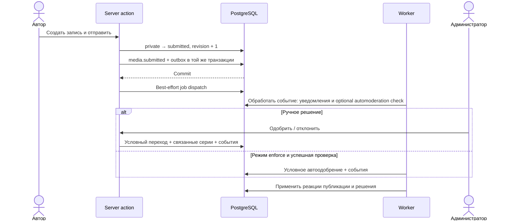

# Жизненные циклы

Проверено по реализации 20 октября 2026 года. Здесь описаны границы транзакций и асинхронных реакций; модель сущностей — в [DATA_MODEL.md](DATA_MODEL.md), подробности источников — в [PROVIDERS.md](PROVIDERS.md), ограничения — в [INVARIANTS.md](INVARIANTS.md). Наличие обработчика или миграции с расписанием не доказывает, что конкретная задача включена в работающем окружении: это состояние таблицы `jobs`.

## 1. Добавление и публикация записи

Автор создаёт `private`-запись; административное создание сразу публикует запись. Отправка автором переводит только собственную запись из `private`/`rejected` в `submitted` либо непосредственно в `published`: выбор зависит от разрешений автора в server action. При отправке на проверку растёт `moderation_revision`, поэтому повторная отправка представляет новую проверяемую редакцию. Отзыв из `submitted` возвращает `private`; редактирование и удаление автором ограничены состояниями черновика/отказа.

Администратор принимает решение только для ещё `submitted`-записи условным обновлением. В той же транзакции он меняет статус предложенных этим же автором серий, связанных с записью. Одобрение удаляет временный `media_item_provider_snapshots`, создаёт `media.published` и, если известен автор вклада, `media.approved`; отказ создаёт `media.rejected`. Изменение записи и события атомарны, но реакции потребителей происходят позже. Опубликованная запись становится частью общего архива: автор вклада не получает право владеть публичным объектом.

Источники: [media actions](../../src/app/author/(protected)/media/actions.ts), [create/submit/review в media-items](../../src/db/queries/media-items.ts), [transaction wrapper](../../src/db/transaction.ts).



## 2. Автомодерация

Режим берётся из `archive_settings`: `off`, `shadow` или `enforce`. Consumer `media.submitted` сверяет текущий статус и редакцию, сохраняет fingerprint входа и проверку, создаёт `job_run` в своей транзакции. Проверка читает **временный снимок предложения** `media_item_provider_snapshots`, а не универсальный `provider_snapshots`: сходные названия скрывают разные назначения.

Политика проверяет совпадение полей со снимком, отсутствие пользовательских альтернативных названий, неопубликованных серий, подозрительного текста и кандидатов в дубли; повторно обращается к провайдеру для проверки доступности и идентичности внешнего объекта. Свежий ответ не используется для полного повторного сравнения всех полей. Это консервативный набор условий автоодобрения, не универсальная содержательная модерация.

В `shadow` сохраняется решение без публикации; `NEEDS_REVIEW` оставляет ручной разбор. В `enforce` автоодобрение дополнительно требует прежние `moderation_revision` и `updated_at`, статус `submitted` и отсутствие неопубликованных серий. Изменённая запись делает проверку `stale`. Успех атомарно публикует запись, завершает check, удаляет снимок предложения и создаёт события публикации, одобрения и автоодобрения.

Восстановление сохраняет одну попытку: существующий jobs recovery завершает осиротевшую проверку как completed / NEEDS_REVIEW. Все записи проверки и approval используют token/lease job; queued/running запуски предотвращают ложное обнаружение сироты, терминальные результаты сохраняются. [Подробности и тесты](P1_RELIABILITY.md).

### Серии и их связи с записями

Предложение новой серии вместе со связью, добавление записи к существующей серии и запрос удаления связи — разные операции с отдельной модерацией. Публикация самой серии не означает автоматическое одобрение всех предложений связей; при ручной модерации записи отдельно действует описанное выше правило для её новых серий того же автора. Изменение иерархии серии сериализуется глобальной advisory-блокировкой, проверяет циклы и допустимую глубину и удаляет избыточные прямые связи с предками, если остаётся связь с потомком. Публичное членство в серии вычисляется общим рекурсивным helper: перенос серии может изменить каталог и прогресс ачивок, даже если запись не редактировалась. Источники: [franchises](../../src/db/queries/franchises.ts), [series membership](../../src/db/queries/series-membership.ts), [achievement consumer](../../src/lib/achievements/consumer.ts).

## 3. Импорт, обновление и повторная обработка метаданных

Поиск обращается к включённым провайдерам с их порядком и fallback, а сохранение выбранного результата отделено от поиска. Для книг загрузчик сохраняет сырые ответы провайдеров и зависимости; применение нормализованных данных выполняется под блокировками записи, источника и снимков, с проверкой, что источник не был изменён за время сети. Внешний HTTP-вызов не включён в долгую транзакцию записи.

`provider.snapshots` разделяет режимы: `refresh` получает и сохраняет снимки без изменения рабочих данных; `process` повторно применяет сохранённые снимки без сети; `refresh-process` делает оба этапа; `verify` сравнивает нормализованный результат, но не является проверкой готовности cutover. Продвижение курсора и checkpoint позволяют продолжить диапазон, а исчерпание квоты откладывает работу. Legacy-адаптеры, game/BGG/Fantlab-бэкфиллы имеют отдельные протоколы; их нельзя считать вариантами одного универсального импорта.

Заявки на унификацию создателей, жанров и платформ сохраняют решение отдельно от его массового применения. Фоновое применение повторно синхронизирует затронутые записи; ручные связи, исключения и вновь открытые заявки ограничивают разрешённые изменения. Синхронизация может завершиться позже административного решения.

Подробные схемы источников, checkpoint, cutover и приоритетов — в [PROVIDERS.md](PROVIDERS.md). Опорный код: [cover registry](../../src/lib/covers/registry.ts), [metadata apply](../../src/db/queries/media-item-metadata.ts), [snapshot job](../../src/lib/providers/snapshot-job.ts), [creator requests](../../src/db/queries/creator-requests.ts).

## 4. Доменное событие и доставка реакций

Это transactional outbox, а не event sourcing: рабочие таблицы остаются источником текущего состояния, каталог событий содержит ограниченный набор значимых переходов. `runInDomainEventTransaction` сохраняет business change, `domain_events` и `domain_event_outbox` в одной транзакции. После commit он пытается создать immediate job; ошибка этой попытки логируется и не отменяет уже сохранённое действие.

Dispatcher блокирует outbox-строку, проверяет тип события, затем в **одной транзакции на событие** исполняет текущих потребителей: ачивки, уведомления, автомодерацию и репутацию. Уникальная пара `(event_id, consumer_key)` защищает DB-эффекты от повторной доставки; claim потребителя и его DB-эффекты коммитятся вместе. `dispatched_at` выставляется после всех реакций. Поэтому ошибка одного потребителя откатывает и остальные реакции этого события.

```mermaid
sequenceDiagram
    participant B as Бизнес-операция
    participant DB as PostgreSQL
    participant W as Dispatcher
    participant C as Consumers
    B->>DB: BEGIN: изменение + event + outbox
    DB-->>B: COMMIT
    B->>DB: Immediate job (best effort)
    W->>DB: Lock outbox; прочитать event
    loop Подходящие consumers
        W->>DB: INSERT consumption ON CONFLICT DO NOTHING
        W->>C: handle(tx, event), если claim получен
        C->>DB: DB-эффекты и возможные новые события
    end
    W->>DB: dispatched_at + COMMIT
    W->>DB: Best-effort jobs новых событий / внешней доставки
```

Периодический recovery выбирает старейшие pending события и продолжает текущий батч после отдельной ошибки. Это страхует потерянную immediate job, но требует включённого расписания и живых scheduler/worker. Recovery выбирает готовые события по next_attempt_at/event_id, сохраняя 60-секундную отсрочку до consumers. Ошибки остаются pending и отображаются в activity log и failed-запусках. [Границы backoff](P1_RELIABILITY.md#продвижение-событий-и-диагностика). Новый consumer автоматически не воспроизводит уже dispatched историю — ему нужен специализированный backfill.

Источники: [transaction wrapper](../../src/db/transaction.ts), [persistence](../../src/lib/domain-events/persistence.ts), [dispatcher](../../src/lib/domain-events/dispatcher.ts), [registry](../../src/lib/domain-events/registry.ts), [best-effort enqueue](../../src/lib/domain-events/queue.ts), [seed recovery](../../drizzle/0060_domain_events_achievements.sql).

## 5. Фоновые задачи и ограничения API

Очередь хранится в PostgreSQL, в `jobs` и `job_runs`. Redis обслуживает ограничения запросов; BullMQ в этом механизме не используется. Scheduler выбирает включённые просроченные расписания через `FOR UPDATE SKIP LOCKED`, создаёт запуск и продвигает `next_run_at` в одной транзакции. Следующее время считается от текущего момента: все пропущенные интервалы после простоя не воспроизводятся.

Worker последовательно исполняет один claimed job за итерацию; несколько процессов могут безопасно разбирать очередь. Claim увеличивает attempts и выдаёт `lock_token` с lease до timeout. Запись успеха, отказа, defer и retry проверяет этот token. Retry использует ограниченную экспоненциальную задержку; defer откладывает запуск без расходования попытки. Recovery возвращает просроченные leases в очередь либо завершает их ошибкой при исчерпании попыток. Политики по умолчанию — три попытки, timeout 300 секунд, задержки 60…3600 секунд; обработчики и расписания могут их менять.

Timeout подаёт `AbortSignal`, но не принудительно останавливает JavaScript/SQL. Lease не продлевается heartbeat. Обработчик обязан кооперативно отменять сеть и проверять владение перед критическими записями: token защищает состояние самой очереди, а не автоматически все доменные эффекты. Мутации, checkpoints и продолжения обработчиков защищены существующим транзакционным guard с финальной проверкой срока; CSV также учитывает signal и публикуется под уникальным ключом попытки. [Охват](P1_RELIABILITY.md#владение-выполнением).

Ограничения провайдеров хранятся в БД и исполняются счётчиками Redis с фиксированными окнами. Авторские квоты на несколько окон проверяются атомарным Lua-скриптом; провайдерные лимиты имеют собственные транспортные особенности. IGDB/RAWG учитывают реальные HTTP-запросы на транспортной границе, а не общий search callback. Проверка остатка для `quotaReserve` и фактическая резервация разделены, поэтому это мягкий резерв при конкуренции. Недоступность Redis блокирует ограничиваемый поиск, но image relay намеренно допускает показ preview при сбое счётчика.

Источники: [scheduler runtime](../../src/jobs/scheduler.ts), [worker runtime](../../src/jobs/worker.ts), [queue queries](../../src/db/queries/jobs.ts), [execution](../../src/lib/jobs/worker.ts), [handlers](../../src/lib/jobs/handlers.ts), [policies](../../src/lib/jobs/model.ts), [API limits](../../src/lib/covers/rate-limits.ts), [Redis implementation](../../src/lib/rate-limits/redis.ts).

## 6. Оценка, статус, опыт знакомства и рецензия

Оценка и статус личного архива согласуются advisory lock на пару автор/запись. Сохранение оценки удаляет текущий статус и создаёт `rating.created` только при новой оценке этого scope; изменение значения не создаёт повторное событие. Установка статуса запрещена при существующей оценке, в том числе оценке части. История первого знакомства хранится независимо, с точностью даты, и не заменяет ни статус, ни оценку.

Оценки всей записи и частей существуют отдельно. Эффективный голос автора для общего рейтинга — явная оценка всей записи, а при её отсутствии среднее оценок частей. Сезон 0 исключается из производного голоса, хотя исторические оценки сохраняются. `media_item_rating_stats` — производная агрегированная таблица с триггерным обновлением и отдельной reconciliation job, не новый источник авторских оценок.

Рецензия хранится в `contributions` и `contribution_reviews`, привязана к записи и необязательной части. Сохранение сериализует операции автора над записью, проверяет scope/конфликты и разрешённое состояние редактирования. Текст и оценка независимы: карточка рецензии получает оценку автора из рейтингов, администратор принимает публикационное решение, не переписывая текст. Новая отправка и переход в публикацию создают соответствующие события; исправление одной привязки части при неизменном тексте сохраняет прежний статус и историю.

Источники: [ratings](../../src/db/queries/ratings.ts), [statuses](../../src/db/queries/author-media-statuses.ts), [experiences](../../src/db/queries/author-media-experiences.ts), [effective ratings](../../src/db/queries/effective-ratings.ts), [parts and aggregate triggers](../../drizzle/0114_title_parts.sql), [reconciliation](../../src/db/queries/media-item-rating-stats.ts), [reviews](../../src/db/queries/contribution-reviews.ts).

## 7. Ачивки, уровни и доверие

Ачивки реагируют на выбранные типы событий. Потребитель определяет затронутых авторов, механики вычисляют актуальный прогресс пакетными SQL-запросами, а выдача уровня фиксируется через уникальную пару автор/уровень и `ON CONFLICT DO NOTHING`. Уже выданные уровни не отзываются; выключение ачивки запрещает новые выдачи. Прогресс не хранится как отдельный изменяемый счётчик. Backfill идёт курсором по авторам, сохраняя общий `award_group_id` в continuation jobs. Toast атомарно помечает группу объявленной до показа: постоянная витрина надёжнее всплывающего объявления, которое может потеряться при закрытии вкладки.

Репутация — отдельный потребитель: он преобразует доменные переходы в `author_action_ledger`, а затем изменяет `author_progress` и `author_trust`. Награда защищена от повторного начисления по бизнес-источнику, поэтому два события публикации/одобрения не начисляют одну награду дважды. Неуспешные решения учитываются отдельно; накопленные XP и достигнутые уровни не отзываются автоматически при удалении исходной активности. Назначение trusted требует совокупности настроенных порогов уровня, trust points, доли успешных решений и длительности истории; ручное подавление auto trust и блокировка автора запрещают продвижение.

Первичная инициализация репутации восстанавливает ledger из доступной текущей/исторической модели в одной транзакции под глобальной блокировкой. Это не полное переигрывание всех событий. Обычные consumers используют совместимую shared-блокировку системы и lock автора. Периодическое продвижение trusted нужно в том числе для порога давности, который может пересечься без нового действия автора.

Источники: [achievement consumer](../../src/lib/achievements/consumer.ts), [evaluation](../../src/lib/achievements/service.ts), [backfill](../../src/lib/achievements/backfill.ts), [announcement claim](../../src/db/queries/achievements.ts), [reputation](../../src/lib/reputation/service.ts), [initialization](../../src/lib/reputation/initialize.ts), [promotion schedule](../../drizzle/0102_reputation_trusted_promotion_job.sql).

## 8. Викторина

Администратор задаёт временной интервал, правильную запись, допустимые media types и лимит попыток. Участие создаётся явно, отдельным join; изменение лимита после появления участников и ответной конфигурации после ответов ограничивается. При ответе блокируются активная викторина и участник, проверяются публикация/доступность выбранной записи и допустимый тип. Неверный ответ уменьшает остаток, верный завершает участие, исчерпание попыток тоже завершает его. `quiz.completed` создаётся только при финальном исходе и запускает ачивки; повтор завершённого участия нового события не создаёт. Блокировка строки викторины сериализует ответы разных участников одной викторины — это сознательно простой протокол, потенциальная точка масштабирования.

Источник: [quizzes](../../src/db/queries/quizzes.ts). Документы [quiz points rollout](../plans/quiz-points-rollout.md) и [publication transports](../plans/quiz-publication-transports.md) — планы; их содержание само по себе не означает наличие функций в текущем коде.

## 9. Уведомления и письма

Consumer уведомлений создаёт внутренние inbox-строки и transport outbox в той же транзакции обработки события. Получатели и внешние маршруты выбираются по типу уведомления и настройкам. Реализованный внешний транспорт здесь — Telegram. Outbox уникален на event/transport/recipient, delivery claim выдаёт 30-секундную аренду с token и увеличивает attempts. Завершение проверяет token, просроченная аренда снова доступна; после 10 попыток сообщение становится failed. Ошибки повторяются с backoff до часа. Успешная отправка и отметка delivered не атомарны относительно Telegram: после обрыва между ними возможен повтор, абсолютной exactly-once гарантии нет.

Авторские email идут через отдельный `email_outbox`, с зашифрованным payload и Resend. Обработчик сначала проверяет готовность провайдера, claim-ит батч, затем последовательно отправляет письма с устойчивым ключом `author-email-outbox-{id}`. Claim выдаёт token и увеличивает attempts; перед отправкой проверяется аренда, completion условен по непросроченному token. Legacy sending с неизвестным исходом отправки помещаются в failed для ручного разбора. Ключ содержит также хеш тела, а гарантия Resend ограничена 24 часами; [переход и ограничения](P1_RELIABILITY.md#email-и-безопасный-переход).

Источники: [notification consumer](../../src/lib/notifications/consumer.ts), [transport outbox](../../src/db/queries/notification-transport-outbox.ts), [delivery](../../src/lib/notifications/outbox-delivery.ts), [retry policy](../../src/lib/notifications/outbox-policy.ts), [email claim](../../src/db/queries/email-outbox.ts), [email delivery](../../src/lib/auth/email-outbox-delivery.ts).

## 10. Регистрация и перенос demo-истории

Обычная регистрация создаёт автора, аккаунт, email, challenge и письмо проверки в одной транзакции. При включённом bootstrap bypass проверки email аккаунт сразу активен, challenge и письмо не создаются. Проверка challenge завершает соответствующий этап обычной регистрации; серверная авторизация не выводится из локальных demo-данных. Отправка письма асинхронна и может отставать от создания аккаунта.

После входа клиент передаёт снимок demo-профиля. Сервер заново разбирает формат, получает доступные автору типы и переносит только опубликованные доступные записи/части. Блокировки автора и личного состояния защищают импорт от конкурентных изменений; существующее серверное состояние имеет приоритет, конфликтующие элементы пропускаются. Только действительно вставленные оценки порождают события. После успешного ответа клиент очищает локальный профиль, только если он всё ещё совпадает с отправленным снимком; ошибка сохраняет локальную историю для повтора. Demo-ачивки остаются локальной проекцией и не импортируются как выданные серверные награды.

Источники: [registration operations](../../src/db/operations/author-auth.ts), [demo action](../../src/app/demo-profile/actions.ts), [import transaction](../../src/db/operations/demo-profile-import.ts), [conditional local cleanup](../../src/lib/user-state/demo-storage.ts).

## 11. Административный экспорт и дамп

Запрос экспорта сохраняет выбранные поля/фильтры и срок хранения, затем ставит job; сбой enqueue помечает экспорт failed. CSV строится курсором по ID батчами по 500, через временный файл с пределом 1 ГБ, загружается в S3-совместимое хранилище и переводится в ready. Это чтение живых данных несколькими запросами, а не согласованный снимок БД; сохранённое поле сортировки не меняет фактический порядок обхода. Просроченные объекты удаляет cleanup job.

Полный дамп имеет отдельный путь: session advisory lock запрещает параллельное формирование, `pg_dump` пишет `.partial`, после успеха файл атомарно переименовывается в локальный `.sql.gz`. Объект попытки сохраняется заранее для восстановления после обрыва. Скачать результат может владелец административного экспорта до истечения срока. Worker и web должны видеть один и тот же каталог дампов; сохранённая строка ready сама по себе не гарантирует доступность файла на другом хосте. Чтение прежних S3-дампов оставлено для совместимости.

Источники: [create/download/retry](../../src/lib/admin-exports/create.ts), [CSV generation/cleanup](../../src/lib/admin-exports/generate.ts), [dump lifecycle](../../src/lib/admin-exports/database-dump.ts), [storage](../../src/lib/admin-exports/storage.ts), [pg_dump](../../src/lib/admin-exports/pg-dump.ts).
